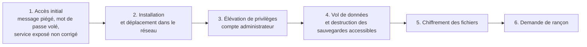

# Cours – Menaces et hygiène numérique

*BTS SIO SISR 1re année – Bloc 3 – S01 – à lire avant le [TP](02-tp.md)*

> [!NOTE] Ce que tu dois savoir déjà
> - **Prérequis :** Aucun (séance d'introduction au bloc 3).
> - **Matériel :** Postes de la salle ; une VM Windows de laboratoire ; navigateur web

## À la fin de ce cours tu sauras

- [ ] **Définir** la cybersécurité par ses quatre principes : disponibilité, intégrité, confidentialité, preuve ;
- [ ] **Distinguer** menace, vulnérabilité, risque et impact sur un cas concret ;
- [ ] **Décrire** le déroulement d'une attaque par rançongiciel et d'une attaque par hameçonnage ;
- [ ] **Repérer** les indices d'un message frauduleux (expéditeur, lien, pièce jointe, urgence) et choisir la bonne réaction ;
- [ ] **Appliquer** les règles d'hygiène numérique et **rédiger** un support de sensibilisation pour des utilisateurs.

## I. Pourquoi parler de cybersécurité ?

Une organisation dépend de son système d'information pour travailler : messagerie, fichiers, logiciel de gestion, accès à internet. La **cybersécurité** est l'ensemble des moyens qui protègent ce système et les données qu'il contient. Elle repose sur quatre principes, que l'on retrouve dans le référentiel du BTS :

| Principe | Question posée | Exemple d'atteinte |
|---|---|---|
| **Disponibilité** | Le service et les données sont-ils accessibles quand on en a besoin ? | Un rançongiciel bloque tous les postes |
| **Intégrité** | Les données sont-elles exactes, non modifiées à l'insu de leur propriétaire ? | Un IBAN est modifié dans une facture |
| **Confidentialité** | Seules les personnes autorisées peuvent-elles lire l'information ? | Une base de clients est publiée en ligne |
| **Preuve** | Peut-on démontrer qui a fait quoi, et quand ? | Aucun journal ne permet de retracer l'intrusion |

**Je vérifie.** Une sauvegarde qu'on ne parvient pas à restaurer, c'est une atteinte à quel principe ?

Voir la réponse

À la **disponibilité** : les données existent, mais on ne peut plus s'en servir. C'est pourquoi on teste les restaurations (voir S05).

### A. Menace, vulnérabilité, risque

Ces mots ne sont pas synonymes.

| Terme | Définition | Exemple |
|---|---|---|
| **Actif** | Ce qu'il faut protéger | Le serveur de fichiers, la base clients |
| **Menace** | Ce qui peut causer un dommage | Un pirate, un rançongiciel, une erreur humaine, un incendie |
| **Vulnérabilité** | Une faiblesse que la menace peut exploiter | Un système non mis à jour, un mot de passe faible |
| **Risque** | La possibilité qu'une menace exploite une vulnérabilité, avec une **gravité** et une **vraisemblance** | « Un rançongiciel chiffre le serveur de fichiers par une faille non corrigée » |
| **Impact** | Les conséquences : arrêt d'activité, perte financière, sanction juridique, atteinte à l'image | Trois jours sans facturation |

On réduit un risque de trois façons : diminuer la vraisemblance (**prévenir**), diminuer la gravité (**limiter**, par exemple avec une sauvegarde) ou l'accepter en connaissance de cause.

### B. Le facteur humain

Les mesures techniques (pare-feu, antivirus, filtrage) arrêtent beaucoup d'attaques, mais pas celles qui **convainquent un utilisateur** d'ouvrir lui-même la porte. L'**ingénierie sociale** désigne l'ensemble des techniques qui manipulent la confiance, la peur, l'urgence ou la curiosité d'une personne. C'est pourquoi l'administrateur ne fait pas que de la technique : il **informe et sensibilise** les utilisateurs, ce qui est une compétence du bloc 3.

## II. Le rançongiciel

Un **rançongiciel** (*ransomware*) est un logiciel malveillant qui **chiffre** les fichiers de la victime, puis réclame une **rançon** contre la clé de déchiffrement. Les attaquants volent souvent aussi des données avant de chiffrer, pour menacer de les publier : c'est la **double extorsion**.

**Cas réel : WannaCry (12 mai 2017).** Ce ver s'est propagé de poste en poste en exploitant une faille du protocole de partage de fichiers de Windows (SMBv1, vulnérabilité **CVE-2017-0144**, outil *EternalBlue*). Microsoft avait publié le correctif (bulletin MS17-010) le **14 mars 2017**, soit près de deux mois avant. Les machines non mises à jour ont été chiffrées : on cite couramment plus de 200 000 machines dans environ 150 pays, dont des hôpitaux britanniques et des industriels. La propagation a été freinée par un chercheur qui a enregistré un nom de domaine servant d'« interrupteur » au code.

**Leçons :** une faille **connue et corrigée** reste exploitable tant qu'on ne met pas à jour ; un service inutile exposé (SMBv1) agrandit la surface d'attaque ; la **sauvegarde hors ligne** est la meilleure parade quand tout le reste a échoué.

> [!WARNING]
> **Payer la rançon ne garantit pas de récupérer ses données** et finance les attaquants. La conduite à tenir en cas d'incident est vue en S17 : isoler, préserver les preuves, prévenir, restaurer.

## III. L'hameçonnage et l'ingénierie sociale

L'**hameçonnage** (*phishing*) est un message qui se fait passer pour un tiers de confiance afin d'obtenir une information (identifiant, code, numéro de carte) ou une action (ouvrir un fichier, effectuer un virement).

| Variante | Canal | Particularité |
|---|---|---|
| **Hameçonnage** classique | Courriel | Envoi de masse, faux site de connexion |
| **Harponnage** (*spear phishing*) | Courriel | Message personnalisé pour une cible précise, informations tirées de réseaux sociaux |
| **Fraude au président** | Courriel, téléphone | Un faux dirigeant ordonne un virement urgent et confidentiel |
| **Smishing** | SMS | Faux suivi de colis, faux remboursement |
| **Vishing** | Téléphone | Faux conseiller bancaire ou faux support technique |

### Les indices d'un message frauduleux

1. **L'expéditeur** : afficher l'adresse réelle, pas seulement le nom (`service@paypa1.example` n'est pas `paypal`).
2. **Le lien** : survoler **sans cliquer** pour lire la vraie adresse ; un nom de domaine proche d'un nom connu est un piège.
3. **La pression** : urgence, menace de fermeture, de sanction, ou au contraire gain inespéré.
4. **La demande** : un mot de passe, un code reçu par SMS ou un virement ne se demandent jamais par message.
5. **La pièce jointe** : archive, fichier exécutable, ou **double extension** (`facture.pdf.exe`).

**Je vérifie.** Un message de « votre directeur » demande un virement urgent et confidentiel sur un nouveau compte. Le texte est parfaitement écrit. Que fais-tu ?

Voir la réponse

On **n'exécute pas** le virement. On vérifie la demande par un **autre canal** (appel au numéro connu du dirigeant), on prévient le service informatique et on conserve le message. Une orthographe correcte ne prouve rien : les messages ciblés sont soignés. La **procédure de validation** d'un virement (double contrôle) est la vraie parade.

## IV. Les règles d'hygiène numérique

L'**hygiène numérique** réunit les gestes simples qui préviennent la plupart des incidents. Elle s'inspire des guides publiés par l'ANSSI (par exemple le *Guide des bonnes pratiques de l'informatique*, rédigé avec la CPME) et par Cybermalveillance.gouv.fr. Les sites officiels évoluent : consulte leur version actuelle.

| Règle | Pourquoi | Séance qui l'approfondit |
|---|---|---|
| Mettre à jour système et logiciels | Corriger les failles connues (voir WannaCry) | S02, S14 |
| Utiliser un antivirus ou une solution de protection à jour | Détecter les logiciels malveillants connus | S02 |
| Choisir des mots de passe longs et uniques, activer la double authentification | Empêcher l'usurpation de compte | S03 |
| N'utiliser que les droits nécessaires, éviter le compte administrateur au quotidien | Limiter les dégâts d'une compromission | S04 |
| Sauvegarder (règle 3-2-1) et tester la restauration | Survivre à un rançongiciel ou à une panne | S05 |
| Chiffrer les supports nomades et les données sensibles | Une perte ou un vol ne devient pas une fuite | S10 |
| Se méfier des messages, liens et pièces jointes | Bloquer l'ingénierie sociale | S01 |
| Verrouiller sa session quand on s'éloigne (`Windows` + `L`) | Éviter l'accès physique | S01 |
| Séparer usages professionnels et personnels | Limiter la propagation et protéger la vie privée | S09 |
| Se connecter avec prudence hors du réseau de l'entreprise (Wi-Fi public, VPN de l'organisation) | Empêcher l'écoute du trafic | S13 |

> [!NOTE]
> Dans une organisation, ces règles figurent dans la **charte informatique**, que les utilisateurs signent. Elle protège aussi l'entreprise : elle fixe ce qui est permis, ce qui est surveillé et les sanctions possibles (voir S08).

## V. Où signaler, où se renseigner

- **Message d'hameçonnage** : le signaler au service informatique de l'organisation ; en usage personnel, à la plateforme officielle de signalement des spams (signal-spam.fr) ; pour un SMS frauduleux, au 33700.
- **Victime d'une infraction numérique** : Cybermalveillance.gouv.fr propose un diagnostic et une mise en relation avec des prestataires ; le dépôt de plainte se fait auprès de la police ou de la gendarmerie (dispositif 17Cyber). Vérifie les dispositifs en vigueur le jour où tu en as besoin.
- **Vulnérabilité ou alerte technique** : le CERT-FR de l'ANSSI publie des avis et des alertes.

## À retenir

- La cybersécurité protège la **disponibilité**, l'**intégrité**, la **confidentialité** et la **preuve**.
- **Risque = menace qui exploite une vulnérabilité**, avec une gravité et une vraisemblance.
- Beaucoup d'attaques passent par l'**utilisateur** : former est une mesure de sécurité à part entière.
- Un rançongiciel se prévient par les **mises à jour**, des **droits limités** et une **sauvegarde testée hors ligne**.
- Devant un message suspect : **ne pas cliquer, vérifier par un autre canal, signaler**.
