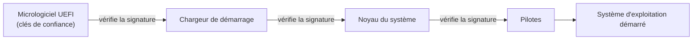

# Cours – Logiciels malveillants et protection du poste

*BTS SIO SISR 1re année – Bloc 3 – S02 – à lire avant le [TP](02-tp.md)*

> [!NOTE] Ce que tu dois savoir déjà
> - **Prérequis :** S01 (menaces, risque, hygiène).
> - **Matériel :** VM Windows de laboratoire (Microsoft Defender actif) ; navigateur web ; accès à virustotal.com en recherche par empreinte

## À la fin de ce cours tu sauras

- [ ] **Classer** les logiciels malveillants (virus, ver, cheval de Troie, rançongiciel, logiciel espion, porte dérobée, rootkit) par mode de propagation et par objectif ;
- [ ] **Lire** un identifiant CVE et un score CVSS, et **expliquer** pourquoi un correctif prime ;
- [ ] **Décrire** les couches de protection d'un poste : mises à jour, antivirus, pare-feu local, droits limités, démarrage sécurisé ;
- [ ] **Expliquer** la chaîne de démarrage sécurisée (UEFI, Secure Boot, TPM) et ce qu'elle empêche ;
- [ ] **Vérifier** l'état de protection d'un poste Windows et **chercher** une empreinte de fichier dans une base de réputation sans y envoyer le fichier.

## I. Les logiciels malveillants

**Malware** (de l'anglais *malicious software*) est le terme général pour tout logiciel conçu pour nuire : voler des données, détruire, prendre le contrôle, extorquer ou espionner. On les classe selon **comment ils se propagent** et **ce qu'ils cherchent**.

| Type | Propagation | But principal | Exemple connu |
|---|---|---|---|
| **Virus** | S'attache à un fichier hôte ; il faut **ouvrir** le fichier | Varié (destruction, vol) | **Melissa** (1999) : macro Word diffusée par courriel |
| **Ver** (*worm*) | **Autonome** : se copie de machine en machine par le réseau, sans action humaine | Propagation, puis charge utile | **Conficker** (2008), **WannaCry** (2017) |
| **Cheval de Troie** (*trojan*) | Se présente comme un logiciel utile ; c'est l'utilisateur qui l'installe | Ouvrir une porte, voler | Faux logiciel piraté, faux « correctif » |
| **Rançongiciel** | Souvent par courriel ou faille exposée | Chiffrer et extorquer | WannaCry (S01) |
| **Logiciel espion** (*spyware*) | Souvent livré par un cheval de Troie | Espionner, collecter | Enregistreur de frappe (*keylogger*) |
| **Porte dérobée** (*backdoor*) | Installée après une première compromission | Garder un accès caché | Compte caché, service de commande à distance |
| **Rootkit** | Installé avec des droits élevés | **Masquer** sa présence au système | Certains outils de persistance |
| **Réseau de machines zombies** (*botnet*) | Machines compromises pilotées à distance | Attaques en masse, envoi de spams | Réseaux de caméras ou de routeurs piratés |
| **Cryptomineur** | Faille ou script web | Utiliser la puissance de calcul de la victime | Script injecté dans un site |

**Je vérifie.** Un salarié reçoit une facture au format Word qui active une « macro ». Une semaine plus tard, plusieurs postes du service sont infectés sans que personne n'ait rien ouvert. Quel type de logiciel a probablement été utilisé en deuxième temps ?

Voir la réponse

Un **ver** : il se propage seul par le réseau en exploitant une faille ou un partage ouvert. Le premier poste a été infecté par une action humaine (macro, donc un virus de type macro ou un cheval de Troie), la suite s'est faite sans intervention.

### Cas historiques

- **Melissa (mars 1999).** Un virus de macro Word s'envoyait aux contacts de la messagerie de la victime. Il a saturé des serveurs de messagerie en quelques jours. Son auteur a été condamné à de la prison aux États-Unis. Leçon : un document n'est pas inoffensif parce qu'il vient d'un contact.
- **Conficker (fin 2008).** Ver exploitant une faille Windows pour laquelle **le correctif existait déjà** depuis octobre 2008 (bulletin MS08-067). Il a infecté des millions de machines dans le monde. Leçon : même schéma que WannaCry, des machines non mises à jour.

## II. Pourquoi les mises à jour priment

Un logiciel contient des erreurs ; certaines sont exploitables : ce sont des **vulnérabilités**. Quand l'éditeur les corrige, il publie un **correctif**. Tant qu'il n'est pas installé, la faille est connue de tous, attaquants compris.

### A. CVE et CVSS

- **CVE** (*Common Vulnerabilities and Exposures*) est un **identifiant unique** attribué à une vulnérabilité publique, par exemple `CVE-2017-0144`. Les fiches se consultent sur le site cve.org et dans la base du NIST (NVD).
- **CVSS** (*Common Vulnerability Scoring System*) est une **note de gravité de 0 à 10**.

| Note CVSS | Gravité |
|---|---|
| 0,0 | Aucune |
| 0,1 à 3,9 | Faible |
| 4,0 à 6,9 | Moyenne |
| 7,0 à 8,9 | Élevée |
| 9,0 à 10,0 | Critique |

Le CVSS mesure la gravité **technique** de la faille. Pour décider de l'urgence dans **ton** organisation, il faut y ajouter le contexte : la machine est-elle exposée à internet ? contient-elle des données sensibles ? existe-t-il déjà une attaque connue ?

### B. Cycle de vie et fin de support

Chaque logiciel a une **date de fin de support** (*end of life*, EOL) : après elle, l'éditeur ne publie plus de correctifs. Un système en fin de support est une **vulnérabilité permanente**. Le technicien tient un **inventaire** (système, version, date de fin de support) pour planifier les migrations.

### C. Une politique de correctifs en entreprise

On ne déploie pas un correctif à tous les postes en même temps : il peut aussi provoquer une panne.

1. **Test** sur quelques machines représentatives ;
2. **Pilote** sur un petit groupe d'utilisateurs ;
3. **Généralisation** ;
4. **Délais plus courts** pour les failles critiques, notamment si la machine est exposée.

Dans un domaine Windows, on pilote tout cela avec **WSUS** ou **Windows Update for Business** et des GPO (voir bloc 2). Sous Linux, on utilise le gestionnaire de paquets (`apt`) et, pour les correctifs de sécurité, les mises à jour automatiques de sécurité.

## III. Les couches de protection d'un poste

Aucune mesure n'est suffisante seule : on empile les protections, c'est la **défense en profondeur**.

| Couche | Rôle | Limite |
|---|---|---|
| **Mises à jour** | Supprimer les failles connues | Ne protège pas des failles inconnues |
| **Antivirus / EDR** | Détecter les codes malveillants par **signatures** (empreintes connues) et par **comportement** | Un code neuf ou modifié peut passer ; il faut des signatures à jour |
| **Pare-feu local** | Filtrer les connexions entrantes et sortantes du poste | Ne bloque pas ce que l'utilisateur autorise |
| **Droits limités** | Un malware lancé avec un compte standard ne peut pas modifier le système | Il garde l'accès aux fichiers de l'utilisateur |
| **Contrôle des applications** | N'autoriser que les programmes prévus (par exemple AppLocker) | Demande une gestion de liste |
| **Macros et scripts maîtrisés** | Désactiver les macros venant d'internet | Peut gêner certains usages |
| **Sauvegarde** | Restaurer après un incident | Doit être testée et hors d'atteinte (S05) |

**EDR** signifie *endpoint detection and response* : un outil qui surveille le comportement du poste et permet de réagir (isoler une machine à distance, par exemple).

## IV. Le démarrage sécurisé

Un malware qui s'installe **avant le système d'exploitation** (rootkit de démarrage) échappe à l'antivirus, qui ne s'est pas encore lancé. Pour l'empêcher, on protège la **chaîne de démarrage**.

- **UEFI** (*Unified Extensible Firmware Interface*) remplace le BIOS classique ; il permet le **Secure Boot** (démarrage sécurisé).
- **Secure Boot** : chaque maillon vérifie la **signature numérique** du suivant avant de lui donner la main. Un élément modifié ou non signé est refusé.
- **TPM** (*Trusted Platform Module*) : puce (ou équivalent) qui **stocke des clés** et enregistre des **mesures** de l'état de démarrage ; BitLocker s'en sert pour ne déverrouiller le disque que si le démarrage est intact.
- **Mot de passe du micrologiciel** : empêche de modifier les réglages (ordre de démarrage, Secure Boot) sans autorisation, par exemple pour démarrer sur une clé USB.
- **Chiffrement du disque** (BitLocker sous Windows, LUKS sous Linux) : un portable volé ne livre pas ses données.

> [!NOTE]
> La désactivation de Secure Boot est parfois nécessaire (démarrage d'un système particulier) : elle doit être **volontaire, documentée et protégée par un mot de passe du micrologiciel**.

**Je vérifie.** Pourquoi un antivirus ne suffit-il pas contre un logiciel malveillant installé dans le chargeur de démarrage ?

Voir la réponse

Parce que ce code s'exécute **avant** le système et donc avant l'antivirus : il peut le tromper ou l'empêcher de démarrer. Secure Boot agit **plus tôt** : il refuse le chargeur modifié.

## À retenir

- On classe un malware par **propagation** (virus : action humaine ; ver : autonome) et par **objectif**.
- Un **CVE** identifie une faille, un **CVSS** note sa gravité de 0 à 10 ; l'urgence dépend aussi du **contexte**.
- Un système **en fin de support** est vulnérable en permanence : on inventorie et on planifie.
- On déploie les correctifs **par étapes** (test, pilote, généralisation).
- La protection d'un poste est une **défense en profondeur** : correctifs, antivirus ou EDR, pare-feu, droits limités, démarrage sécurisé, chiffrement, sauvegarde.
