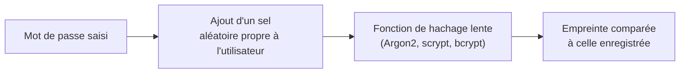

# Cours – Authentification : mots de passe et authentification multifacteur

*BTS SIO SISR 1re année – Bloc 3 – S03 – à lire avant le [TP](02-tp.md)*

> [!NOTE] Ce que tu dois savoir déjà
> - **Prérequis :** S01 (menaces), S02 (empreinte, défense en profondeur) ; notions de comptes Windows et Linux (bloc 2, S02).
> - **Matériel :** VM Debian de laboratoire (paquets `john` et `oathtool`) ; VM Windows de laboratoire ; gestionnaire de mots de passe (KeePass ou équivalent libre)

## À la fin de ce cours tu sauras

- [ ] **Distinguer** identification, authentification et autorisation ;
- [ ] **Calculer** l'entropie d'un mot de passe et **comparer** longueur, complexité et phrase de passe ;
- [ ] **Décrire** les attaques sur les mots de passe (force brute, dictionnaire, réutilisation, hameçonnage) et leurs parades ;
- [ ] **Expliquer** comment un mot de passe doit être stocké (empreinte salée, fonction lente) ;
- [ ] **Comparer** les facteurs d'authentification (SMS, application TOTP, clé FIDO2) et **justifier** un choix ;
- [ ] **Rédiger** une politique de mots de passe argumentée avec les recommandations de la CNIL.

## I. Identifier, authentifier, autoriser

Trois mots à ne pas confondre :

| Étape | Question | Exemple |
|---|---|---|
| **Identification** | Qui dis-tu être ? | Tu donnes ton identifiant `alice` |
| **Authentification** | Peux-tu le prouver ? | Tu fournis ton mot de passe, un code, une clé |
| **Autorisation** | Qu'as-tu le droit de faire ? | Tu peux lire le dossier Compta, pas le modifier (voir S04) |

Authentifier s'appuie sur un ou plusieurs **facteurs** :

| Facteur | Ce que c'est | Exemples |
|---|---|---|
| **Ce que je sais** | Un secret mémorisé | Mot de passe, code PIN |
| **Ce que je possède** | Un objet | Téléphone, clé de sécurité, carte à puce |
| **Ce que je suis** | Une caractéristique du corps | Empreinte digitale, visage |

L'**authentification multifacteur** (MFA) exige **au moins deux facteurs de types différents** : un mot de passe et un code, par exemple. Deux mots de passe ne font pas du multifacteur.

## II. La force d'un mot de passe : l'entropie

Un attaquant doit essayer des combinaisons. Leur nombre dépend de la **taille de l'alphabet** (N : nombre de caractères possibles) et de la **longueur** (L). On le mesure en **bits d'entropie** :

> **Entropie (bits) = L × log₂(N)**

Chaque bit supplémentaire **double** le nombre d'essais. Pour un mot de passe tiré **au hasard** :

| Mot de passe (tiré au hasard) | Alphabet N | Entropie ≈ | Combinaisons ≈ |
|---|---|---|---|
| PIN de 4 chiffres | 10 | 13 bits | 10⁴ |
| 8 minuscules | 26 | 38 bits | 2 × 10¹¹ |
| 8 caractères parmi 95 (tous types) | 95 | 53 bits | 7 × 10¹⁵ |
| 12 caractères parmi 95 | 95 | 79 bits | 5 × 10²³ |
| 16 minuscules | 26 | 75 bits | 4 × 10²² |
| 20 minuscules | 26 | 94 bits | 2 × 10²⁸ |
| Phrase de passe de 6 mots tirés au hasard dans une liste de 7 776 mots | 7 776 | 78 bits | 2 × 10²³ |

> [!NOTE]
> Ces valeurs supposent un tirage **vraiment aléatoire**. Un mot de passe que **tu** choisis (`Soleil2024!`) est bien moins fort que sa longueur ne le laisse croire, parce que les humains choisissent des mots, des dates et des habitudes de substitution (`a` devient `@`) que les attaquants essaient en premier.

### De l'entropie au temps de calcul

Si un attaquant dispose de ses propres copies d'empreintes (attaque **hors ligne**) et de matériel puissant, un ordre de grandeur est **10 milliards d'essais par seconde** sur un format de hachage rapide. C'est une **hypothèse de cours**, pas une mesure.

| Mot de passe | Entropie | Temps pour tout essayer (hypothèse 10¹⁰ essais/s) |
|---|---|---|
| 8 minuscules | 38 bits | environ 21 secondes |
| 8 caractères parmi 95 | 53 bits | environ 8 jours |
| 12 caractères parmi 95 | 79 bits | environ 1,7 million d'années |

**Je vérifie.** Un mot de passe de 8 caractères « complexe » est-il meilleur qu'une phrase de 4 mots ordinaires choisis par toi ? Pourquoi est-ce une question piège ?

Voir la réponse

Tout dépend de **qui choisit** : 8 caractères tirés au hasard donnent 53 bits, mais un humain en retient de moins aléatoires. Quatre mots **tirés au hasard** dans une grande liste donnent environ 52 bits ; quatre mots **choisis** par toi (une citation, une expression connue) valent beaucoup moins. Pour une phrase de passe, on **tire au hasard** et on prend **plus de mots** (six ou sept).

### Les recommandations de la CNIL

La CNIL ne fixe pas une longueur unique mais un niveau d'entropie selon la situation :

| Situation | Entropie minimale recommandée |
|---|---|
| Mot de passe **seul**, sans autre mesure | **80 bits** |
| Mot de passe avec **restriction d'accès** (temporisation, blocage après échecs) | **50 bits** |
| Authentification avec un **objet détenu** (carte, téléphone) et blocage après 3 échecs | **13 bits** (le code PIN du téléphone) |

Pour atteindre 80 bits avec un mot de passe seul, la CNIL cite par exemple : **12 caractères** de quatre types (avec un choix large de caractères spéciaux), ou **14 caractères** (majuscules, minuscules, chiffres), ou une **phrase de passe d'au moins 7 mots**. Elle ne recommande **pas de renouvellement périodique** pour les comptes standards (il reste demandé pour les comptes à privilèges) et rappelle de **bloquer** le compte ou de temporiser après des échecs (par exemple après 10 échecs). Ces valeurs sont à relire sur le site de la CNIL.

## III. Les attaques sur les mots de passe

| Attaque | Principe | Parade |
|---|---|---|
| **Force brute** | Essayer toutes les combinaisons | Mot de passe long, blocage après échecs |
| **Dictionnaire** | Essayer des mots courants, des variantes (`Password1!`) et des mots de passe déjà fuités | Ne pas choisir de mot courant ; **refuser** les mots de passe connus comme compromis |
| **Bourrage d'identifiants** (*credential stuffing*) | Réessayer ailleurs des couples identifiant / mot de passe volés sur un autre site | **Un mot de passe différent par service**, MFA |
| **Pulvérisation** (*password spraying*) | Essayer un mot de passe courant sur **beaucoup de comptes** pour éviter le blocage | Détection dans les journaux (S15), MFA |
| **Hameçonnage** | Obtenir le mot de passe de la victime elle-même | Sensibilisation, clé FIDO2 (voir plus bas) |
| **Enregistreur de frappe** | Logiciel espion qui lit la saisie | Antivirus, MFA |
| **Table précalculée** (*rainbow table*) | Retrouver un mot de passe à partir d'une empreinte déjà calculée | **Sel** (voir plus bas) |

Le **bourrage d'identifiants** est la raison principale pour laquelle la **réutilisation** est dangereuse : le mot de passe d'un forum de loisirs fuite, et c'est ton compte professionnel qui est visé.

## IV. Comment stocker un mot de passe

Un service ne doit **jamais** conserver les mots de passe en clair, ni chiffrés avec une clé qu'il possède. Il conserve une **empreinte** (*hash*) : résultat d'une fonction **à sens unique**. À la connexion, il calcule l'empreinte de ce qu'on saisit et compare.

- Le **sel** (*salt*) est une valeur aléatoire, **propre à chaque utilisateur**, ajoutée avant le calcul : deux utilisateurs ayant le même mot de passe ont des empreintes **différentes**, et les tables précalculées deviennent inutilisables.
- Une fonction **lente** (Argon2, scrypt, bcrypt, citées par la CNIL) rend chaque essai coûteux, donc l'attaque hors ligne beaucoup moins rapide qu'avec un format rapide comme MD5 ou SHA-1.
- Le sel **ne rend pas** un mauvais mot de passe bon : `soleil` reste trouvé en quelques essais par un dictionnaire.

## V. Le second facteur

| Second facteur | Principe | Forces | Faiblesses |
|---|---|---|---|
| **Code par SMS** | Un code est envoyé par SMS | Facile à déployer | Interception, détournement de numéro (*SIM swap*) ; ne résiste pas à l'hameçonnage |
| **Application TOTP** | Un code à 6 chiffres calculé à partir d'un secret partagé et de l'heure, renouvelé toutes les 30 secondes | Hors ligne, gratuit | Un faux site peut collecter le code en temps réel |
| **Notification « Valider »** | L'utilisateur approuve sur son téléphone | Simple | **Lassitude** : l'attaquant envoie des demandes en rafale jusqu'à ce que l'utilisateur accepte |
| **Clé de sécurité FIDO2 / passkey** | Une clé cryptographique liée au **site réel** | Résiste à l'hameçonnage : une clé ne répond pas à un faux site | Coût, gestion des clés de secours |
| **Biométrie** | Empreinte, visage | Pratique | Non révocable : on ne change pas ses empreintes |

Le **TOTP** (*Time-based One-Time Password*, norme RFC 6238) calcule le code à partir du **secret** partagé à l'inscription (le QR code) et de l'**heure** : l'application et le serveur trouvent le même code sans communiquer.

**Je vérifie.** Un attaquant a envoyé un faux site de connexion parfait. L'utilisateur y saisit son mot de passe **et** le code TOTP, que l'attaquant rejoue aussitôt sur le vrai site. Quel second facteur aurait empêché cela ?

Voir la réponse

La **clé FIDO2 / passkey** : elle ne signe un défi que pour le **nom de domaine réel** enregistré ; sur le faux site, elle ne répond pas. Un code TOTP, lui, se recopie.

## VI. Gérer ses mots de passe

On ne peut pas retenir des dizaines de mots de passe longs et uniques : on utilise un **gestionnaire de mots de passe** (KeePass, Bitwarden ou équivalent), protégé par **une** phrase de passe forte et par un second facteur. Il génère des mots de passe aléatoires, les remplit sur le **bon site** (ce qui aide aussi à repérer un faux site) et chiffre la base.

Dans une organisation, on y ajoute :

- une **politique de mots de passe** (longueur, blocage après échecs, refus des mots de passe compromis) ;
- le **MFA** au minimum pour les accès à distance, les comptes administrateur et la messagerie ;
- des **comptes d'administration distincts** des comptes du quotidien (voir S04) ;
- un **processus de réinitialisation** sérieux : une réinitialisation qui se contente d'une question « nom de votre premier animal » est une porte ouverte.

## À retenir

- **Identifier, authentifier, autoriser** sont trois étapes différentes.
- **Entropie = L × log₂(N)** ; elle suppose un tirage aléatoire. **La longueur compte plus que la complexité apparente.**
- La CNIL raisonne en niveau d'entropie : **80 bits** seul, **50 bits** avec restriction d'accès.
- **Un mot de passe par service**, un gestionnaire, du MFA pour les accès sensibles.
- On stocke une **empreinte salée avec une fonction lente**, jamais le mot de passe.
- Seule une **clé FIDO2 / passkey** résiste vraiment à l'hameçonnage.
