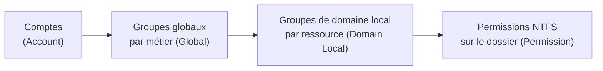

# Cours – Droits d'accès, privilèges et moindre privilège

*BTS SIO SISR 1re année – Bloc 3 – S04 – à lire avant le [TP](02-tp.md)*

> [!NOTE] Ce que tu dois savoir déjà
> - **Prérequis :** S03 (authentification) ; comptes, groupes et permissions NTFS (bloc 2, S02 et S10) ; permissions Linux (bloc 2, S06).
> - **Matériel :** VM Debian de laboratoire (paquet `acl`) ; VM Windows de laboratoire

## À la fin de ce cours tu sauras

- [ ] **Expliquer** le principe du moindre privilège et la séparation des tâches ;
- [ ] **Comparer** les modèles de contrôle d'accès DAC, MAC et RBAC et **situer** leur usage ;
- [ ] **Construire** une matrice de droits à partir des besoins métier ;
- [ ] **Appliquer** cette matrice avec des groupes et des permissions (Linux : groupes, `chmod`, ACL ; Windows : NTFS, `icacls`) ;
- [ ] **Organiser** la vie des comptes : arrivée, changement de poste, départ, accès temporaire, comptes à privilèges ;
- [ ] **Vérifier** les droits réellement en place et **détecter** un écart.

## I. Le principe du moindre privilège

Une fois l'utilisateur authentifié (S03), il faut décider **ce qu'il a le droit de faire** : c'est l'**autorisation**. Le principe directeur est le **moindre privilège** :

> **Chaque utilisateur, chaque programme et chaque service ne reçoit que les droits nécessaires à sa mission, et seulement pour la durée nécessaire.**

**Pourquoi ?** Un compte compromis, par erreur ou par attaque, agit avec les droits de son propriétaire. Plus ces droits sont larges, plus l'incident est grave. Reprenons l'exemple de S01 : un comptable ouvre une pièce jointe piégée.

| Situation | Conséquence |
|---|---|
| Le comptable travaille avec un compte **administrateur** | Le code malveillant peut désactiver l'antivirus, s'installer dans le système, se propager avec des droits élevés |
| Le comptable travaille avec un compte **standard** | Le code est limité aux fichiers de ce compte ; la propagation est beaucoup plus difficile |

### Principes associés

| Principe | Idée | Exemple |
|---|---|---|
| **Séparation des tâches** | Deux personnes pour une action sensible | Le comptable saisit un virement, le directeur le valide |
| **Besoin d'en connaître** | On n'accède qu'aux informations utiles à sa mission | Un commercial n'a pas accès aux dossiers RH |
| **Droits temporaires** | Un droit exceptionnel est accordé pour une durée limitée et tracé | Un développeur lit un dossier de facturation le temps de corriger un bogue |
| **Révocation** | Un droit qui n'est plus utile est retiré | Départ ou changement de poste |
| **Traçabilité** | Chaque action est rattachée à un compte nominatif | Pas de compte partagé (voir S15) |

**Je vérifie.** Un technicien est administrateur du domaine « parce que c'est plus pratique ». Quelles sont deux conséquences si son poste est compromis ?

Voir la réponse

L'attaquant obtient les droits d'administration **sur tout le domaine** : il peut créer des comptes, désactiver les protections, lire ou chiffrer tous les partages. De plus, ses actions sont **confondues avec celles du technicien** : la preuve devient difficile. La parade est un **compte d'administration distinct** du compte quotidien, utilisé seulement pour les tâches d'administration.

## II. Les modèles de contrôle d'accès

| Modèle | Qui décide des droits ? | Fonctionnement | Usage |
|---|---|---|---|
| **DAC** (contrôle d'accès **discrétionnaire**) | Le **propriétaire** de la ressource | Il partage son fichier avec qui il veut | Permissions Windows NTFS et Linux classiques |
| **MAC** (contrôle d'accès **obligatoire**) | Une **politique centrale** que l'utilisateur ne peut pas modifier | Les ressources ont un niveau de classification, les utilisateurs une habilitation | Environnements à forte exigence ; SELinux et AppArmor sous Linux |
| **RBAC** (contrôle d'accès par **rôles**) | L'administrateur, **via des rôles** | On donne les droits à des **rôles** (commercial, comptable), puis on affecte des utilisateurs aux rôles | **Le plus courant en entreprise** : groupes de sécurité Active Directory |

Dans le **RBAC**, un changement de poste se traduit par un changement de groupe, pas par une revue de chaque dossier. Le risque est l'**explosion des rôles** : trop de groupes presque identiques rendent la gestion illisible.

### La mise en œuvre sous Windows : AGDLP

Dans un domaine Active Directory, on évite de donner des droits à des personnes. L'enchaînement classique est **AGDLP** :

Les utilisateurs entrent dans un **groupe de métier** (`G_Compta`), qui est lui-même membre d'un **groupe de ressource** (`DL_Compta_Modif`) auquel on donne la permission NTFS. Pour changer l'accès d'un dossier, on modifie un seul groupe.

### La mise en œuvre sous Linux

Les permissions classiques (propriétaire, groupe, autres) couvrent les cas simples. On y ajoute :

- le **bit setgid** sur un dossier (`chmod 2770`) : les nouveaux fichiers héritent du **groupe** du dossier ;
- les **ACL** (`setfacl`) quand il faut donner un droit à un deuxième groupe sans changer les permissions de base ;
- `sudo` pour déléguer **uniquement** des commandes précises à un utilisateur ou un groupe (fichier `/etc/sudoers`, édité avec `visudo`).

## III. La matrice de droits

Une **matrice de droits** met en regard les **groupes** (en lignes) et les **ressources** (en colonnes), avec le niveau d'accès à l'intersection.

| Légende | Signification |
|---|---|
| — | Aucun accès |
| L | Lecture |
| L+E | Lecture et écriture |
| L+E+S | Lecture, écriture et suppression |
| A | Administration |

La construction suit toujours le même chemin :

1. **Recenser les ressources** et leur sensibilité (qu'est-ce qui est confidentiel ?) ;
2. **Recenser les métiers** et leurs besoins réels ;
3. **Proposer** la matrice, la **faire valider** par le responsable de chaque donnée ;
4. **L'appliquer** par des groupes, jamais par des droits individuels ;
5. **Tester** avec des comptes d'essai ;
6. **La revoir** périodiquement.

> [!NOTE]
> La **revue périodique des droits** est un contrôle essentiel : les droits s'accumulent avec le temps (changements de poste, projets terminés). Elle consiste à demander à chaque responsable de **confirmer** la liste des personnes ayant accès à ses données, et à retirer le reste.

## IV. La vie d'un compte

| Événement | Actions |
|---|---|
| **Arrivée** | Demande validée par le responsable, création du compte nominatif, affectation aux groupes du métier, remise d'un secret initial à changer, signature de la charte |
| **Changement de poste** | Retrait des anciens groupes, ajout des nouveaux, revue des accès particuliers |
| **Accès temporaire** | Demande écrite, validation, droit **limité en durée** et en périmètre, trace conservée, retrait à l'échéance |
| **Départ** | **Désactivation le jour du départ** (pas de suppression immédiate : on garde les données utiles), récupération du matériel, transfert de ses fichiers, révocation des accès externes (VPN, messagerie, outils en ligne) |
| **Comptes à privilèges** | Compte d'administration **séparé**, MFA, journalisation renforcée, mot de passe long ; pour les comptes locaux d'administration des postes, une solution comme **Windows LAPS** génère un mot de passe **différent par machine** |

## V. Contrôler que les droits sont ceux qu'on croit

Une matrice n'a de valeur que si la réalité la suit. On vérifie :

- **Sous Linux** : `ls -l`, `getfacl`, `id utilisateur`, `sudo -l -U utilisateur` ;
- **Sous Windows** : `icacls dossier`, `Get-Acl`, l'onglet *Sécurité* ; l'entrée **« Tout le monde »** en *Contrôle total* sur un dossier sensible est un écart classique ;
- **Par des tests** : se connecter avec un compte d'essai de chaque groupe et essayer d'accéder.

**Je vérifie.** Un dossier de partage a une ACL dont l'une des entrées est `Utilisateurs authentifiés : modification`. Que doit faire l'administrateur, et dans quel ordre ?

Voir la réponse

1. **Identifier** les besoins réels et les groupes concernés ;
2. **Ajouter** les droits via les groupes de métier ;
3. **Tester** avec un compte de chaque groupe ;
4. **Retirer** l'entrée trop large ;
5. **Documenter** le changement. Retirer d'abord provoque une coupure de service ; tester avant protège la continuité.

## À retenir

- **Moindre privilège** : le strict nécessaire, pour la durée nécessaire.
- **RBAC** : on donne les droits à des **rôles (groupes)**, pas à des personnes. Sous Windows : **AGDLP**.
- Une **matrice de droits** se construit depuis les **besoins métier** et se **revoit** régulièrement.
- Compte **nominatif**, compte d'**administration séparé**, MFA pour les comptes à privilèges.
- **Départ = désactivation le jour même.** Un accès temporaire est **limité, validé et tracé**.
- On **vérifie** les droits réels : `icacls`, `getfacl`, comptes d'essai.
