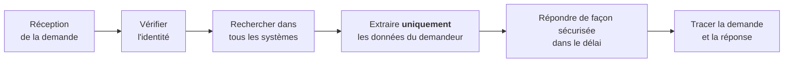

# Cours – Collecte, base légale, consentement et droits des personnes

*BTS SIO SISR 1re année – Bloc 3 – S07 – à lire avant le [TP](02-tp.md)*

> [!NOTE] Ce que tu dois savoir déjà
> - **Prérequis :** S06 (notions, principes, registre).
> - **Matériel :** VM Debian de laboratoire (paquet `sqlite3`) ; navigateur web avec outils de développement

## À la fin de ce cours tu sauras

- [ ] **Choisir** une base légale adaptée à un traitement (les six bases de l'article 6) ;
- [ ] **Reconnaître** un consentement valide (libre, spécifique, éclairé, univoque) et un consentement non conforme ;
- [ ] **Rédiger** les mentions d'information d'un formulaire de collecte ;
- [ ] **Analyser** le comportement d'un site vis-à-vis des cookies et traceurs ;
- [ ] **Citer** les droits des personnes et les délais de réponse ;
- [ ] **Traiter** techniquement une demande d'accès et une demande d'effacement sur une base de données.

## I. Sur quel fondement collecter ?

Le principe de **licéité** (S06) impose que chaque traitement repose sur une **base légale** (article 6). Il y en a six ; le **consentement** n'est qu'une d'entre elles.

| Base légale | Quand | Exemple |
|---|---|---|
| **Consentement** | La personne accepte, pour une finalité précise | Newsletter promotionnelle, cookies publicitaires |
| **Contrat** | Le traitement est nécessaire à l'exécution d'un contrat ou à des mesures précontractuelles | Adresse de livraison d'une commande |
| **Obligation légale** | La loi impose le traitement | Conservation des factures, déclarations sociales |
| **Intérêts vitaux** | Protéger la vie d'une personne | Urgence médicale |
| **Mission d'intérêt public** | Autorité publique | Traitement d'un service public |
| **Intérêt légitime** | Intérêt de l'organisation, à condition que les droits des personnes ne priment pas | Sécurité du réseau, prévention de la fraude |

> [!NOTE]
> On choisit la base légale **avant** de collecter et on la **documente** dans le registre. Changer de base légale après coup parce qu'on s'est trompé n'est pas permis. Un même traitement n'a pas à additionner les bases : on choisit **la plus adaptée**.

**Je vérifie.** Une entreprise de livraison collecte l'adresse du client pour livrer. Faut-il recueillir son consentement ?

Voir la réponse

Non : la base légale est le **contrat** (livrer la commande suppose de connaître l'adresse). Demander un consentement serait même **trompeur** : le client pourrait le retirer, et la livraison deviendrait impossible. Un **consentement** serait en revanche nécessaire pour utiliser cette adresse à des fins de **démarchage commercial** d'un autre type.

## II. Le consentement valide

Quand le consentement est la base légale, il doit être (articles 4 et 7) :

| Caractère | Signification | Contre-exemple |
|---|---|---|
| **Libre** | Sans contrainte, sans conditionner un service qui n'en a pas besoin | « Accepte tout ou pas d'accès » |
| **Spécifique** | Une finalité par consentement | Une seule case pour la newsletter **et** le partage avec des partenaires |
| **Éclairé** | La personne sait qui, quoi, pourquoi | Texte juridique illisible |
| **Univoque** | Un acte positif **clair** | **Case pré-cochée**, silence, poursuite de la navigation |

En plus :

- le responsable doit pouvoir **prouver** le consentement (qui, quand, à quel texte) ;
- le **retrait** doit être **aussi simple** que le consentement ;
- en France, un mineur de **moins de 15 ans** ne peut consentir seul à certains services en ligne : l'accord d'un titulaire de l'autorité parentale est nécessaire.

## III. Informer les personnes

À la collecte, la personne doit être informée (articles 13 et 14), **de façon concise, claire et accessible** :

- l'**identité** du responsable et les coordonnées du DPO s'il y en a un ;
- les **finalités** et la **base légale** ;
- les **destinataires** et les éventuels transferts hors Union européenne ;
- la **durée de conservation** ;
- les **droits** (accès, rectification, effacement…), le droit de **retirer** le consentement, le droit de **saisir la CNIL**.

Une présentation **à deux niveaux** est courante : une mention courte sous le formulaire, avec un lien vers la politique de confidentialité complète.

La protection des données **dès la conception** et **par défaut** (article 25) demande de prévoir ces éléments **dans l'architecture** : ne collecter que le nécessaire, régler par défaut les options les plus protectrices.

## IV. Cookies et traceurs

Un **traceur** (cookie, identifiant publicitaire, pixel) lit ou écrit des informations sur le terminal de l'utilisateur. La règle française (loi Informatique et Libertés, article 82, reprise de la directive ePrivacy) est :

| Type de traceur | Consentement préalable ? |
|---|---|
| **Strictement nécessaire** au service demandé (panier, authentification, sécurité, équilibrage de charge) | **Non** |
| Mesure d'audience **limitée** à des statistiques anonymes, selon des conditions précises de la CNIL | Non, sous conditions |
| **Publicité ciblée**, réseaux sociaux, suivi inter-sites | **Oui** |

Selon les lignes directrices de la CNIL : **refuser doit être aussi simple qu'accepter** (un bouton de refus au même niveau que le bouton d'acceptation), les traceurs soumis au consentement **ne sont pas déposés avant** le choix, et le choix de l'utilisateur est conservé pour une durée limitée (la CNIL recommande de le lui redemander après environ **six mois**). Ces points sont à relire sur le site de la CNIL.

**Je vérifie.** Un site affiche « En poursuivant votre navigation, vous acceptez les cookies ». Est-ce conforme ?

Voir la réponse

**Non** : la poursuite de la navigation n'est pas un acte positif **clair** ; le consentement doit être explicite, avec un choix réel (accepter ou refuser) avant le dépôt de traceurs non essentiels.

## V. Les droits des personnes

| Droit | Contenu | Article |
|---|---|---|
| **Information** | Savoir comment les données sont traitées | 13, 14 |
| **Accès** | Obtenir **copie** de ses données et des informations sur le traitement | 15 |
| **Rectification** | Corriger des données inexactes | 16 |
| **Effacement** (« droit à l'oubli ») | Faire supprimer ses données dans certains cas | 17 |
| **Limitation** | Geler le traitement pendant une vérification | 18 |
| **Portabilité** | Récupérer ses données dans un format structuré, courant et lisible par une machine, ou les faire transmettre à un autre responsable | 20 |
| **Opposition** | S'opposer à un traitement (toujours pour la prospection) | 21 |
| **Décision automatisée** | Ne pas être soumis à une décision fondée uniquement sur un traitement automatisé produisant des effets importants | 22 |

**Délai :** le responsable répond **dans un mois** à compter de la réception de la demande ; ce délai peut être prolongé de **deux mois** si la demande est complexe ou nombreuses, à condition d'en informer la personne dans le premier mois. L'exercice des droits est **gratuit**, sauf demandes manifestement infondées ou excessives.

Le droit à l'**effacement** n'est pas absolu : on ne supprime pas ce qu'une **obligation légale** impose de conserver (par exemple des pièces comptables) ; on **limite** alors l'accès et on **supprime le reste**.

### Le rôle du technicien dans une demande d'accès

Trois pièges : **ne pas vérifier l'identité** (on risque de livrer des données à un tiers), **oublier un système** (sauvegardes, messagerie, fichiers en vrac : d'où le registre de S06), **divulguer les données d'autres personnes** dans l'export.

## À retenir

- Six **bases légales** (article 6) : on choisit **avant** de collecter et on la documente.
- **Consentement valide** = libre, spécifique, éclairé, **univoque** ; pas de case pré-cochée ; retrait aussi simple.
- L'**information** à la collecte est obligatoire (identité, finalité, base légale, durée, droits, CNIL).
- Cookies : consentement préalable sauf **strictement nécessaires** ; **refuser aussi simple qu'accepter**.
- Droits : accès, rectification, effacement, limitation, portabilité, opposition, décision automatisée ; réponse **sous un mois**.
- L'effacement cède devant une **obligation légale de conservation**.
