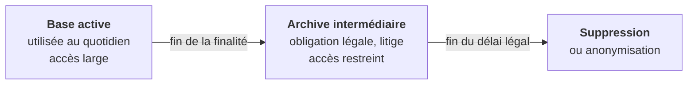
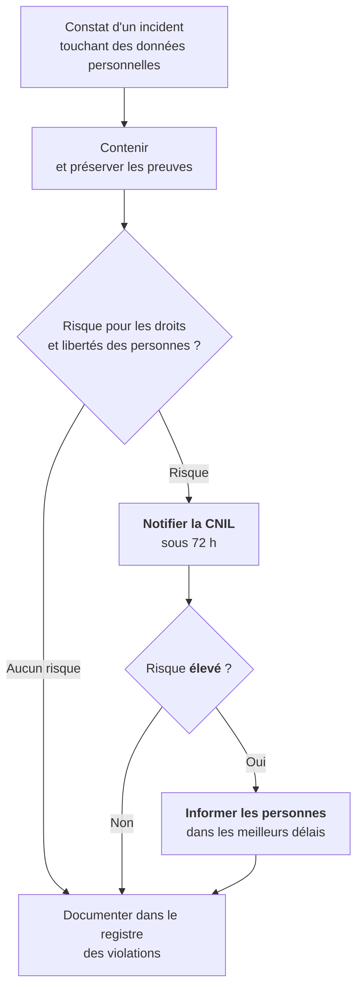

# Cours – Conservation, sécurité du traitement, sous-traitance et violations de données

*BTS SIO SISR 1re année – Bloc 3 – S08 – à lire avant le [TP](02-tp.md)*

> [!NOTE] Ce que tu dois savoir déjà
> - **Prérequis :** S06 (principes, registre) et S07 (droits, effacement).
> - **Matériel :** VM Debian de laboratoire (paquets `sqlite3`, `cron`) ; éditeur de texte

## À la fin de ce cours tu sauras

- [ ] **Définir** une durée de conservation et les trois phases de vie d'une donnée (base active, archive, suppression) ;
- [ ] **Écrire** une purge automatique d'une base de données et d'un dossier de journaux ;
- [ ] **Distinguer** pseudonymisation et anonymisation ;
- [ ] **Citer** les mesures de sécurité de l'article 32 et les mentions d'un contrat de sous-traitance (article 28) ;
- [ ] **Qualifier** une violation de données et **préparer** la notification à la CNIL dans le délai de 72 heures.

## I. Combien de temps conserver ?

Le principe de **limitation de la conservation** (article 5) impose de ne garder les données **que le temps nécessaire** à la finalité. Il n'existe pas de durée universelle : on la **fixe**, on la **justifie** et on l'écrit dans le registre (S06).

### Les trois phases de vie d'une donnée

| Phase | Ce qui la justifie | Qui y accède |
|---|---|---|
| **Base active** | La finalité est en cours (la relation commerciale, le contrat de travail) | Les équipes opérationnelles |
| **Archive intermédiaire** | Une **obligation légale** ou un risque de litige (pièces comptables, prescription) | Un petit nombre de personnes, **sur demande** |
| **Suppression** | Plus aucune justification | Personne |

### Ordres de grandeur

> [!WARNING]
> Ces durées sont **indicatives** et **évoluent** : on les confirme auprès du service juridique ou sur les sites officiels (CNIL, Légifrance) avant de les appliquer. Ce ne sont pas des consignes à recopier.

| Donnée | Durée usuellement retenue |
|---|---|
| Pièces comptables (factures) | **10 ans** (Code de commerce) |
| Bulletins de paie (double conservé par l'employeur) | **5 ans** en pratique, avec des obligations de conservation plus longues pour d'autres documents sociaux |
| Candidature non retenue | **2 ans** au plus après le dernier contact (recommandation CNIL, avec l'accord du candidat au-delà) |
| Prospect (prospection commerciale) | **3 ans** à compter du dernier contact (recommandation CNIL) |
| Enregistrement de vidéosurveillance | **un mois** au plus en pratique (recommandation CNIL) |
| Journaux de connexion (hébergeurs et fournisseurs d'accès) | **1 an** (obligation légale) |

### Pseudonymisation et anonymisation

| | **Pseudonymisation** | **Anonymisation** |
|---|---|---|
| Principe | Remplacer l'identité par un **pseudonyme** (un code, un hachage salé) | Rendre la ré-identification **impossible** |
| La donnée reste-t-elle personnelle ? | **Oui** (on peut ré-identifier avec une information supplémentaire conservée à part) | **Non**, si l'anonymisation est irréversible |
| Le RGPD s'applique-t-il ? | Oui, avec une mesure de **sécurité** appréciée | Non, une fois anonyme |
| Exemple | `client_4821` à la place de « Camille Roux » | Statistiques agrégées sans aucune donnée individuelle |

> [!NOTE]
> Attention : **hacher** une adresse courriel avec SHA-256 ne l'anonymise pas. Il suffit de calculer les empreintes de millions d'adresses plausibles pour retrouver la bonne. Le **sel secret** et la clé conservée à part rendent l'opération beaucoup plus sûre, sans la rendre irréversible.

### Mettre en œuvre la conservation

Sans automatisation, les durées restent des vœux. Un technicien met en place :

- une **purge planifiée** des bases (requête SQL lancée par **cron**, tâche planifiée sous Windows) ;
- la **rotation des journaux** (`logrotate`) avec une durée maximale ;
- la **purge des sauvegardes** : une donnée supprimée de la base disparaît des sauvegardes à l'expiration de leur rétention (voir S05) ;
- une **trace** de ce qui a été purgé (date, nombre de lignes, jamais le contenu).

## II. Sécuriser le traitement : l'article 32

L'article 32 demande des mesures techniques et organisationnelles **adaptées au risque**. Il cite en particulier :

| Mesure | Exemple | Séance |
|---|---|---|
| **Pseudonymisation** et **chiffrement** | Disque chiffré, base chiffrée, TLS | S05, S10 |
| **Confidentialité, intégrité, disponibilité, résilience** | Droits minimaux, sauvegardes, redondance | S04, S05 |
| **Rétablir** l'accès aux données dans un délai approprié | Plan de reprise, sauvegarde testée | S05 |
| **Tester et évaluer** régulièrement l'efficacité des mesures | Audit, scan de vulnérabilités | S16 |

Il n'y a pas de liste de mesures obligatoires : c'est au responsable de traitement de **démontrer** (article 5, responsabilité) que ses choix sont adaptés.

## III. Sous-traitance : l'article 28

Un **sous-traitant** traite des données **pour le compte** du responsable : hébergeur, éditeur d'un logiciel en ligne (SaaS), prestataire de paie, entreprise de maintenance qui accède aux données. Le responsable doit choisir un sous-traitant qui offre des garanties suffisantes et conclure un **contrat** qui précise au minimum :

| Élément du contrat | Pourquoi |
|---|---|
| Objet, durée, nature et finalité du traitement | Cadrer le périmètre |
| Types de données et catégories de personnes | Savoir ce qui est confié |
| Traitement **uniquement sur instruction** documentée du responsable | Le sous-traitant ne détourne pas les données |
| Engagement de **confidentialité** du personnel | Protéger les données |
| **Mesures de sécurité** (article 32) | Niveau de protection attendu |
| Recours à un **autre sous-traitant** (sous-traitance en cascade) avec autorisation | Maîtriser la chaîne |
| **Aide** du sous-traitant pour les droits des personnes et les violations | Répondre dans les délais |
| **Sort des données** en fin de contrat (suppression ou restitution) | Pas de copie résiduelle |
| Droit d'**audit** par le responsable | Contrôler |

En tant que technicien ou administrateur, tu es souvent la personne qui **donne un accès** à un prestataire : vérifie qu'un contrat existe et que l'accès est **limité et tracé** (S04).

## IV. Les violations de données : articles 33 et 34

### Définition

Une **violation de données à caractère personnel** est une atteinte à la **sécurité** qui entraîne, de manière accidentelle ou illicite, la **destruction**, la **perte**, l'**altération**, la **divulgation** ou l'**accès non autorisé** à des données personnelles. Elle couvre les trois principes de la sécurité :

| Type | Principe atteint | Exemple |
|---|---|---|
| Violation de **confidentialité** | Confidentialité | Fichier clients envoyé au mauvais destinataire, base copiée par un attaquant |
| Violation d'**intégrité** | Intégrité | Données modifiées par un attaquant |
| Violation de **disponibilité** | Disponibilité | Rançongiciel qui chiffre le fichier clients sans sauvegarde |

### Que faire ?

| Obligation | Détail |
|---|---|
| **Documenter** toute violation | Dans un **registre des violations**, **même sans notification** (faits, effets, mesures) |
| **Notifier la CNIL** | Sans retard et si possible **72 heures au plus tard** après en avoir pris connaissance, **sauf** si la violation n'est pas susceptible d'engendrer un risque |
| **Informer les personnes** | Dans les meilleurs délais, si le risque est **élevé** (article 34) ; pas obligatoire si les données étaient **chiffrées** de façon efficace |
| Pour un **sous-traitant** | Prévenir le responsable de traitement **dans les meilleurs délais** |

### Contenu de la notification

La notification décrit : la **nature** de la violation (catégories et nombre approximatif de personnes et de données), les **coordonnées** du DPO ou d'un contact, les **conséquences probables**, les **mesures prises ou envisagées**. Si certaines informations manquent, on notifie quand même et on **complète ensuite**.

### Évaluer la gravité

On croise trois critères :

| Critère | Questions |
|---|---|
| **Nature des données** | Identité seule ? Santé, finances, mots de passe, pièces d'identité ? |
| **Volume et personnes** | Combien de personnes ? Des mineurs ou des personnes vulnérables ? |
| **Facilité d'exploitation** | Données lisibles ou chiffrées ? Publiques ou entre les mains d'un tiers malveillant ? |

Plus les données sont sensibles, nombreuses et lisibles, plus le risque est élevé.

## À retenir

- La conservation est **limitée**, **fixée** et **justifiée** ; elle s'automatise (purge, rotation, rétention des sauvegardes).
- **Pseudonymiser** n'est pas **anonymiser** : la donnée pseudonymisée reste personnelle.
- Un **sous-traitant** agit sur **instruction** et sous **contrat** (article 28).
- Violation de données : **contenir, documenter, évaluer, notifier la CNIL sous 72 h** si risque, **informer les personnes** si risque élevé.
- Toute violation est inscrite au **registre des violations**, même sans notification.
