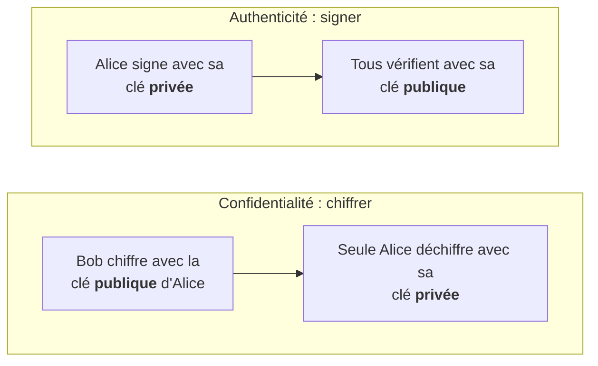
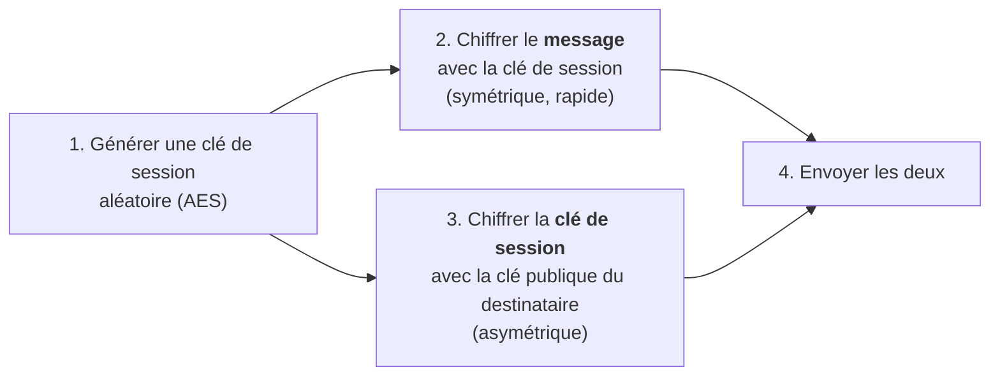
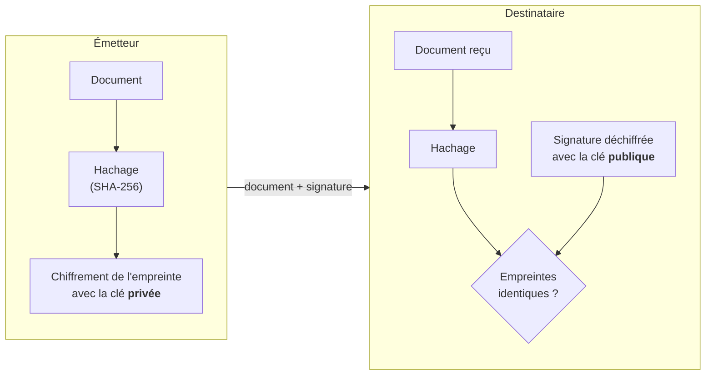
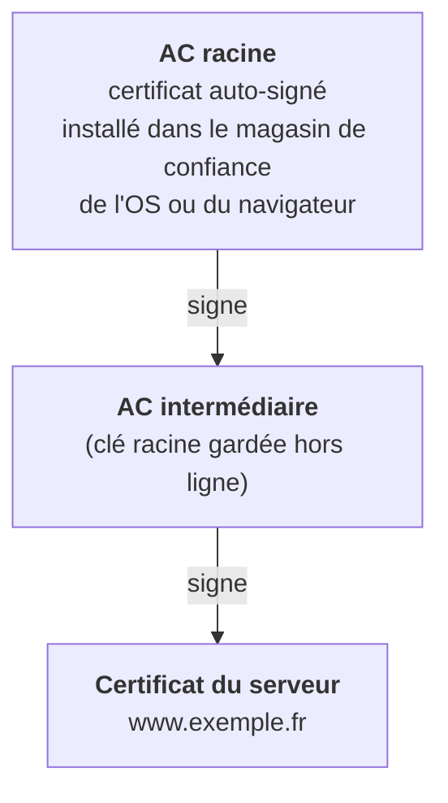
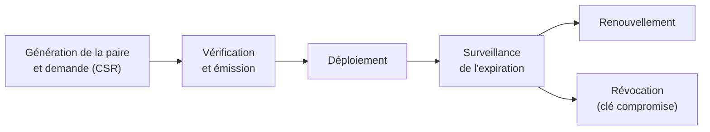
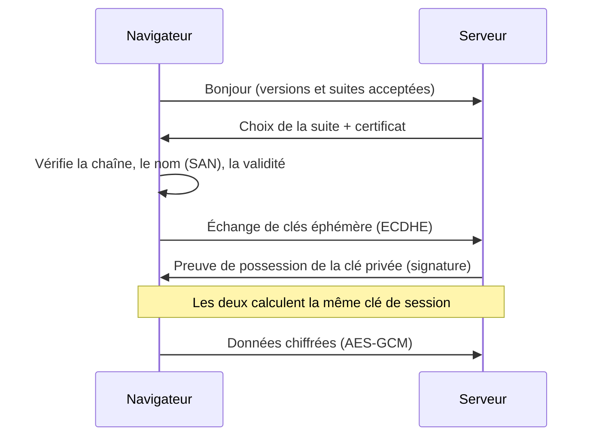

# Cours – Chiffrement asymétrique, signature numérique, certificats et PKI

*BTS SIO SISR 1re année – Bloc 3 – S11 – à lire avant le [TP](02-tp.md)*

> [!NOTE] Ce que tu dois savoir déjà
> - **Prérequis :** S10 (chiffrement symétrique, hachage, HMAC).
> - **Matériel :** VM Debian de laboratoire (`openssl`, `gpg`) ; navigateur web

## À la fin de ce cours tu sauras

- [ ] **Expliquer** le principe d'une paire de clés (publique / privée) et ses deux usages : chiffrer et signer ;
- [ ] **Décrire** le chiffrement hybride et l'échange de clés Diffie-Hellman ;
- [ ] **Générer** une paire de clés, **chiffrer** une clé de session, **signer** et **vérifier** un fichier avec OpenSSL ;
- [ ] **Lire** un certificat X.509 et en citer les champs essentiels ;
- [ ] **Décrire** les acteurs d'une PKI, la chaîne de confiance et le cycle de vie d'un certificat.

## I. Le chiffrement asymétrique

### Une paire de clés

En S10, la clé symétrique devait être partagée **avant** de pouvoir communiquer en secret. La cryptographie **asymétrique** supprime ce problème : chaque personne possède **deux clés** mathématiquement liées.

| Clé | Qui la connaît ? | Rôle |
|---|---|---|
| **Clé publique** | **Tout le monde** (on la distribue librement) | Chiffrer pour son propriétaire ; **vérifier** sa signature |
| **Clé privée** | **Son propriétaire seul** | Déchiffrer ; **signer** |

Ce qui est chiffré par une clé ne se déchiffre qu'avec l'**autre** clé de la paire. On ne peut pas, en pratique, déduire la clé privée de la clé publique.

### Deux usages, deux sens

> [!WARNING]
> **Chiffrer** : on utilise la clé **publique du destinataire**. **Signer** : on utilise sa **propre clé privée**. La clé privée ne quitte **jamais** son propriétaire ; si elle est volée, tout est compromis.

### Algorithmes courants

| Algorithme | Usage | Taille ou courbe recommandée |
|---|---|---|
| **RSA** | Chiffrement, signature | 2048 bits au minimum ; **3072 bits** conseillé pour durer (recommandations ANSSI et NIST, à vérifier) |
| **ECDSA**, **Ed25519** | Signature (courbes elliptiques) | Courbes P-256 ou Curve25519 |
| **ECDH**, **X25519** | Échange de clés | Courbes elliptiques |

Les **courbes elliptiques** offrent une sécurité équivalente avec des clés beaucoup plus courtes, donc des calculs plus rapides.

### Le chiffrement hybride

Le chiffrement asymétrique est **lent** et limité à de petits messages. En pratique, on **combine** les deux familles :

C'est le principe de TLS, de GnuPG, de S/MIME et de la plupart des protocoles sécurisés.

### L'échange de clés Diffie-Hellman

L'**échange de clés Diffie-Hellman** permet à deux interlocuteurs de **fabriquer un secret commun** en échangeant uniquement des valeurs publiques, sur un canal observable. Chacun garde une valeur privée, envoie la valeur publique associée, puis calcule le même secret. Un espion qui voit les valeurs publiques ne peut pas retrouver le secret.

Utilisé avec des clés **éphémères** (nouvelle paire à chaque session), il apporte la **confidentialité persistante** (*forward secrecy*) : même si une clé privée est volée plus tard, les sessions passées enregistrées restent illisibles.

> [!NOTE]
> Diffie-Hellman seul n'**authentifie** pas les interlocuteurs : un attaquant placé au milieu peut mener deux échanges (attaque de l'homme du milieu). D'où le besoin de **signatures** et de **certificats**.

## II. La signature numérique

Une signature prouve **qui** a produit un document et que le document **n'a pas changé**.

| Si la vérification… | Alors |
|---|---|
| **réussit** | Le document n'a pas changé **et** a bien été signé avec la clé privée correspondante |
| **échoue** | Le document a été modifié, ou la signature n'est pas celle de cette clé |

Elle garantit l'**intégrité**, l'**authenticité** et la **non-répudiation** (contrairement au HMAC, S10), à condition de savoir **à qui appartient la clé publique**. C'est le rôle des certificats.

## III. Les certificats numériques

### Le problème

Si Bob reçoit une clé publique « d'Alice », comment sait-il qu'elle est vraiment à Alice, et pas à un attaquant qui se fait passer pour elle ?

Un **certificat** (norme **X.509**) est un document numérique qui **lie une identité à une clé publique**, et qui est **signé par une autorité de confiance**.

### Les champs essentiels

| Champ | Contenu |
|---|---|
| **Sujet** (*Subject*) | À qui appartient le certificat (nom de domaine, organisation) |
| **Émetteur** (*Issuer*) | L'autorité qui l'a signé |
| **Validité** | Dates de début et de fin |
| **Clé publique** | La clé du sujet, avec son algorithme |
| **Nom alternatif** (*Subject Alternative Name*, SAN) | Les noms de domaine valables (le navigateur contrôle **celui-ci**) |
| **Usage de la clé** | Ce que le certificat peut faire (authentifier un serveur, signer…) |
| **Numéro de série** | Identifiant unique chez l'émetteur |
| **Signature** | Celle de l'émetteur sur tout le reste |

## IV. L'infrastructure à clés publiques (PKI)

Une **PKI** (*Public Key Infrastructure*) est l'ensemble des acteurs, règles et outils qui émettent, distribuent, valident et révoquent les certificats.

| Acteur | Rôle |
|---|---|
| **Autorité de certification (AC)** | Émet et signe les certificats ; sa clé privée est protégée au plus haut niveau |
| **Autorité d'enregistrement (AE)** | Vérifie l'identité du demandeur avant l'émission |
| **Titulaire** | Le serveur ou la personne qui possède le certificat |
| **Utilisateur de confiance** | Le navigateur ou le système qui vérifie le certificat |
| **Service de révocation** | **CRL** (liste de révocation) ou **OCSP** (interrogation en ligne) |

### La chaîne de confiance

Le navigateur remonte la chaîne : le certificat du serveur est signé par l'intermédiaire, lui-même signé par une racine **présente dans son magasin de confiance**. Il vérifie aussi la **validité**, le **nom** (SAN) et l'état de **révocation**.

> [!NOTE]
> On garde la clé de l'**AC racine hors ligne** et on signe avec une **intermédiaire** : si l'intermédiaire est compromise, on la révoque sans perdre la racine.

### Types de certificats

| Type | Vérification | Usage |
|---|---|---|
| **DV** (*Domain Validated*) | Le demandeur contrôle le domaine | Sites web, automatisable (Let's Encrypt, protocole ACME) |
| **OV** (*Organization Validated*) | Existence de l'organisation | Sites d'entreprise |
| **EV** (*Extended Validation*) | Vérification approfondie | Sites sensibles (le navigateur n'affiche plus de signe particulier) |
| **Auto-signé** | Aucune | Tests, laboratoires : **non reconnu** par défaut |
| **Certificat interne** | AC de l'entreprise | Intranet, VPN, Wi-Fi d'entreprise |

### Cycle de vie

Les incidents classiques viennent de la **gestion** : un certificat **expiré** qui coupe un service, une clé privée copiée trop largement, un certificat oublié dans un inventaire. Un technicien tient un **inventaire** des certificats avec leurs dates d'expiration.

## V. Dans TLS

Quand tu ouvres un site en HTTPS :

On y retrouve **tout le chapitre** : certificat (identité), signature (authenticité), Diffie-Hellman éphémère (secret + confidentialité persistante), chiffrement symétrique authentifié (rapidité + intégrité).

## À retenir

- **Chiffrer** : clé **publique** du destinataire. **Signer** : **sa** clé privée. La clé privée ne se partage pas.
- On chiffre le message en **symétrique**, et la clé de session en **asymétrique** (**hybride**).
- **Diffie-Hellman** crée un secret commun ; en **éphémère**, il apporte la confidentialité persistante.
- Une **signature** garantit intégrité, authenticité et non-répudiation.
- Un **certificat** lie une identité à une clé publique, signé par une **AC** ; la **chaîne de confiance** remonte à une racine connue du système.
- Un certificat se **gère** : inventaire, renouvellement avant l'expiration, révocation en cas de compromission.
