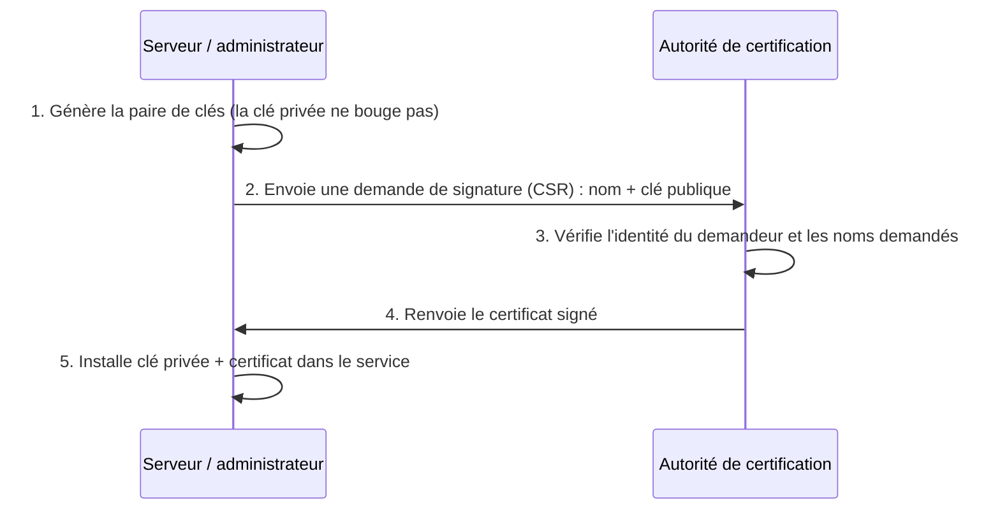

# Cours – Déployer des certificats : AC interne, serveur HTTPS et révocation

*BTS SIO SISR 1re année – Bloc 3 – S12 – à lire avant le [TP](02-tp.md)*

> [!NOTE] Ce que tu dois savoir déjà
> - **Prérequis :** S11 (certificats, chaîne de confiance, signature).
> - **Matériel :** VM Debian de laboratoire (`openssl`, `nginx`, `curl`) ; droits `sudo`

## À la fin de ce cours tu sauras

- [ ] **Créer** une autorité de certification interne et en **protéger** la clé privée ;
- [ ] **Émettre** un certificat de serveur à partir d'une demande de signature (CSR) avec noms alternatifs ;
- [ ] **Configurer** un serveur web en HTTPS et **faire reconnaître** l'autorité par un client ;
- [ ] **Diagnostiquer** les trois erreurs courantes : nom, expiration, chaîne non reconnue ;
- [ ] **Révoquer** un certificat, **publier** la liste de révocation et vérifier son effet.

## I. Pourquoi une autorité de certification interne ?

Les services **internes** (intranet, outil de supervision, interface d'un équipement, applications métier) ont des noms de domaine qui n'existent pas sur Internet : une autorité publique ne leur délivre pas de certificat. Deux options :

| Option | Avantage | Inconvénient |
|---|---|---|
| Certificat **auto-signé** par service | Rapide | Avertissement partout ; aucune chaîne ; on apprend aux utilisateurs à **ignorer** les alertes |
| **AC interne** | Un seul certificat racine à installer ; une confiance centralisée ; renouvellements gérables | Il faut protéger la clé de l'AC et maintenir un petit service de gestion |

Une **AC interne** est un petit système dont la **clé privée est la plus précieuse de l'entreprise** : qui la possède peut émettre des certificats pour n'importe quel nom, et tous les postes qui font confiance à l'AC les accepteront. D'où les règles :

- stocker la clé privée **hors ligne** quand l'AC ne signe pas (poste isolé, support chiffré, coffre) ;
- protéger la clé par un **mot de passe fort** (le TP la laisse sans mot de passe parce qu'il s'agit d'un laboratoire) ;
- utiliser une **AC intermédiaire** pour signer au quotidien, la racine restant hors ligne ;
- tenir un **inventaire** des certificats émis (le fichier `index.txt` d'OpenSSL en est un minimal) ;
- limiter les **durées de validité** (quelques mois pour un serveur).

## II. Émettre un certificat de serveur

### Le circuit d'une demande



**La clé privée du serveur n'est jamais envoyée à l'AC.** Seule la **CSR** (*Certificate Signing Request*) circule : elle contient la clé publique et les noms demandés, signés avec la clé privée pour prouver qu'on la détient.

### Les noms : le champ qui compte

Les navigateurs vérifient le nom du site dans le champ **SAN** (*Subject Alternative Name*), plus dans le « CN ». Un certificat valable pour `www.lab.local` seulement est **refusé** pour `lab.local` ou `autre.lab.local` : c'est une cause fréquente d'erreur. Un certificat « joker » (*wildcard*) `*.lab.local` couvre un niveau de sous-domaine, mais augmente l'impact d'une fuite de la clé.

### Les extensions utiles

| Extension | Valeur pour un serveur | Pourquoi |
|---|---|---|
| `basicConstraints` | `CA:FALSE` | Le certificat ne peut **pas** signer d'autres certificats |
| `keyUsage` | `digitalSignature, keyEncipherment` | Usages limités |
| `extendedKeyUsage` | `serverAuth` | Authentification d'un serveur |
| `subjectAltName` | Les noms de domaine | Ce que vérifie le client |
| `crlDistributionPoints` | URL de la liste de révocation | Où le client vérifie la révocation |

## III. Configurer le service

### Côté serveur

Le service web a besoin de deux fichiers : le **certificat** (public) et la **clé privée** (protégée, lisible par root et le service seulement). Avec nginx :

```nginx
server {
    listen 443 ssl;
    server_name www.lab.local;
    ssl_certificate     /etc/nginx/pki/www.crt;
    ssl_certificate_key /etc/nginx/pki/www.key;
    ssl_protocols       TLSv1.2 TLSv1.3;
    root /var/www/lab;
}
server {
    listen 80;
    server_name www.lab.local;
    return 301 https://$host$request_uri;
}
```

| Réglage | Rôle |
|---|---|
| `ssl_protocols TLSv1.2 TLSv1.3` | N'accepte que les versions de TLS considérées comme sûres (SSL, TLS 1.0 et 1.1 sont à bannir) |
| Redirection `80 → 443` | Pas de service en clair |
| En-tête **HSTS** (`Strict-Transport-Security`) | Dit au navigateur de ne plus jamais utiliser HTTP pour ce site (à n'activer qu'une fois HTTPS stable) |
| Droits de la clé privée | `chmod 600`, propriétaire `root` |

### Côté client

Un client fait confiance à une AC s'il possède son certificat racine dans son **magasin de confiance**. En entreprise, on déploie le certificat racine par **stratégie de groupe** (Windows) ou par l'outil de gestion de parc ; sur Debian, on le dépose dans `/usr/local/share/ca-certificates/` puis `update-ca-certificates`.

> [!WARNING]
> Installer une AC dans le magasin de confiance, c'est **lui faire confiance pour tous les sites**. Ne le fais **jamais** pour une AC dont tu ne maîtrises pas la clé. Dans ce TP, tu **retires** l'AC de laboratoire à la fin.

## IV. Diagnostiquer une erreur de certificat

| Message (exemples) | Cause probable | Vérification |
|---|---|---|
| **Le nom ne correspond pas** (*hostname mismatch*, `ERR_CERT_COMMON_NAME_INVALID`) | Le nom saisi n'est pas dans le SAN | `openssl x509 -noout -ext subjectAltName` |
| **Certificat expiré** (`ERR_CERT_DATE_INVALID`) | Date de fin dépassée, ou **horloge** du poste fausse | `openssl x509 -noout -dates` ; `date` |
| **Autorité inconnue** (*unable to get local issuer certificate*, `ERR_CERT_AUTHORITY_INVALID`) | L'AC n'est pas dans le magasin du client ; **chaîne incomplète** (intermédiaire non envoyée par le serveur) | `openssl s_client -connect hote:443 -showcerts` |
| **Certificat révoqué** | Le certificat figure dans la CRL | `openssl verify -crl_check` |
| **Protocole non pris en charge** | Version de TLS ou suite incompatible | `openssl s_client -tls1_2 -connect …` |

La méthode : **lire l'erreur exactement**, puis vérifier dans l'ordre le **nom**, les **dates**, la **chaîne**, la **révocation**. Une erreur qu'on contourne (« continuer quand même ») est une erreur qu'on n'a pas comprise.

## V. Révoquer

Quand une clé privée est compromise ou qu'un certificat n'a plus lieu d'être, l'AC le **révoque**. Elle publie une **liste de révocation** (CRL) signée, ou répond à des requêtes **OCSP**. Le client vérifie la révocation s'il est configuré pour le faire : la révocation n'est utile que si elle est **vérifiée**. Les certificats à durée de vie courte réduisent aussi le besoin de révocation.

## VI. Et sur Internet ?

Pour un site public, on utilise une AC publique gratuite comme **Let's Encrypt** par le protocole **ACME** : un agent (`certbot`, `acme.sh`…) prouve que le serveur contrôle le nom de domaine, obtient un certificat et le **renouvelle automatiquement** (certificats de courte durée). La leçon vaut aussi en interne : **automatiser le renouvellement** évite les pannes par expiration.

## À retenir

- Une **AC interne** donne une confiance centralisée ; sa **clé privée** est le secret le plus critique : hors ligne, protégée, avec une intermédiaire pour le quotidien.
- La clé privée du serveur **ne quitte pas** le serveur ; on envoie une **CSR**.
- Le client vérifie le **nom (SAN)**, la **validité**, la **chaîne** et la **révocation**.
- Installer une AC dans le magasin de confiance est un acte grave : on le fait pour sa propre AC, et on retire les AC de laboratoire.
- **Automatiser** le renouvellement et **surveiller** les dates d'expiration.
