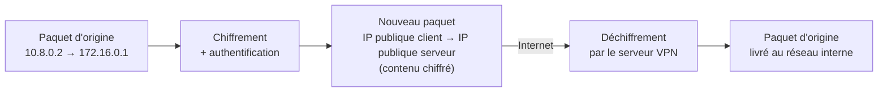
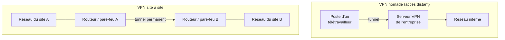
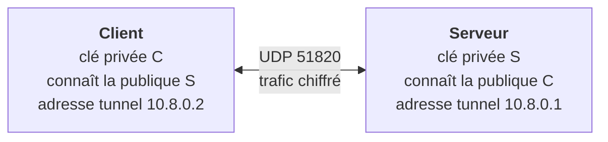

# Cours – VPN : principes, protocoles et architecture

*BTS SIO SISR 1re année – Bloc 3 – S13 – à lire avant le [TP](02-tp.md)*

> [!NOTE] Ce que tu dois savoir déjà
> - **Prérequis :** S10 et S11 (chiffrement, clés publiques et privées) ; notions de routage IP.
> - **Matériel :** Deux VM Debian de laboratoire sur un réseau interne (`wireguard`, `tcpdump`) ; droits `sudo`

## À la fin de ce cours tu sauras

- [ ] **Définir** un VPN et la tunnelisation, et **distinguer** VPN nomade et VPN site à site ;
- [ ] **Comparer** IPsec, OpenVPN et WireGuard (usage, forces, limites) ;
- [ ] **Monter** un tunnel WireGuard avec une paire de clés par machine ;
- [ ] **Vérifier** que le trafic est chiffré et que seules les routes prévues passent par le tunnel ;
- [ ] **Citer** les mesures de sécurité d'un VPN d'entreprise (authentification, moindre privilège, journalisation).

## I. Qu'est-ce qu'un VPN ?

Un **VPN** (*Virtual Private Network*, réseau privé virtuel) crée un **tunnel chiffré et authentifié** à travers un réseau non sûr (Internet) pour relier deux extrémités comme si elles étaient sur le même réseau privé.

Il apporte, grâce à S10 et S11 :

| Garantie | Mécanisme |
|---|---|
| **Confidentialité** | Chiffrement symétrique du trafic |
| **Intégrité** | Mode authentifié ou HMAC |
| **Authentification** des extrémités | Clés publiques, certificats, secrets partagés, MFA |

### La tunnelisation

La **tunnelisation** consiste à **encapsuler** un paquet entier dans un autre paquet, après l'avoir chiffré.

Un observateur sur Internet ne voit que **deux adresses publiques** et des données chiffrées.

## II. Deux grands usages

| | **VPN nomade** | **VPN site à site** |
|---|---|---|
| Qui se connecte | Un **utilisateur** depuis un poste | Deux **réseaux** entre eux |
| Durée | À la demande | Permanent |
| Authentification | Utilisateur + appareil (**MFA** recommandé) | Équipements (clés, certificats) |
| Exemple | Télétravailleur qui accède au partage de fichiers | Agence reliée au siège |

## III. Les protocoles

| Protocole | Principe | Points forts | Limites |
|---|---|---|---|
| **IPsec** (IKEv2) | Intégré à la couche réseau, négociation par IKE, chiffrement ESP | Standard, très répandu sur les routeurs et pare-feu, idéal en **site à site** | Configuration complexe, nombreuses options (donc erreurs possibles) |
| **OpenVPN** | S'appuie sur **TLS** (certificats), en UDP ou TCP | Souple, passe les pare-feu (port 443 TCP), mature | Plus lourd, plus lent que WireGuard |
| **WireGuard** | Noyau Linux, une **paire de clés par machine**, cryptographie moderne figée | **Simple**, rapide, code très court (donc plus facile à auditer) | Pas d'attribution dynamique d'adresses ni de gestion d'utilisateurs intégrées, UDP seulement |
| **VPN SSL** (portail) | Accès par navigateur à des applications précises | Pas de client à installer | Limité aux applications publiées |

> [!NOTE]
> **Choisir** : site à site entre pare-feu → IPsec ; nomades avec gestion d'utilisateurs → OpenVPN ou une solution commerciale ; besoin de simplicité et de performances, avec un petit nombre de machines → WireGuard. Le bon choix dépend aussi de **ce que gèrent déjà** le pare-feu et l'équipe.

### Le principe de WireGuard

Chaque machine possède une **clé privée** et une **clé publique**. Une machine ne parle qu'aux **pairs** dont elle connaît la clé publique, et leur associe des **adresses autorisées** (`AllowedIPs`).

`AllowedIPs` joue **deux rôles** :
1. à l'**envoi** : le trafic vers ces adresses est envoyé dans le tunnel (c'est une **table de routage**) ;
2. à la **réception** : le trafic venant du pair n'est accepté que si l'adresse source en fait partie (**filtrage**).

## IV. Tunnel complet ou partiel

| Mode | `AllowedIPs` du client | Effet |
|---|---|---|
| **Tunnel complet** (*full tunnel*) | `0.0.0.0/0` | **Tout** le trafic passe par l'entreprise : contrôle et journalisation, mais plus de bande passante et de latence |
| **Tunnel partiel** (*split tunnel*) | Seuls les réseaux d'entreprise | Seul le trafic d'entreprise est tunnelisé ; le reste sort directement |

Le tunnel partiel est plus léger, mais le trafic Internet de l'utilisateur échappe aux contrôles de l'entreprise. Le choix est une décision de **sécurité**.

## V. Sécuriser un VPN d'entreprise

Un VPN est une **porte d'entrée vers le réseau interne** : il doit être exemplaire.

| Mesure | Détail |
|---|---|
| **Authentification forte** | Clé ou certificat **et** second facteur utilisateur (S03) |
| **Moindre privilège** | Le tunnel donne accès aux **services nécessaires**, pas à tout le réseau (pare-feu derrière le VPN, S14) |
| **Postes de confiance** | Poste à jour, chiffré, antivirus actif (S02) ; contrôle de conformité avant connexion |
| **Cycle de vie des clés** | Une clé par appareil ; **révocation** au départ ou à la perte (S04) |
| **Journalisation et alertes** | Qui s'est connecté, quand, d'où (S15) |
| **Maintenance** | Mises à jour du serveur VPN (des vulnérabilités critiques touchent régulièrement les équipements d'accès distant) |
| **Exposition minimale** | Un seul port ouvert, protocoles et versions à jour |

## À retenir

- Un VPN crée un **tunnel chiffré et authentifié** : confidentialité, intégrité, authentification des extrémités.
- **Nomade** (utilisateur) ou **site à site** (réseaux) ; protocoles **IPsec**, **OpenVPN**, **WireGuard**.
- WireGuard : une paire de clés par machine, `AllowedIPs` = routage **et** filtrage.
- **Tunnel complet** ou **partiel** : décision de sécurité.
- Un VPN est une **porte d'entrée** : MFA, moindre privilège, révocation, journaux, mises à jour.
