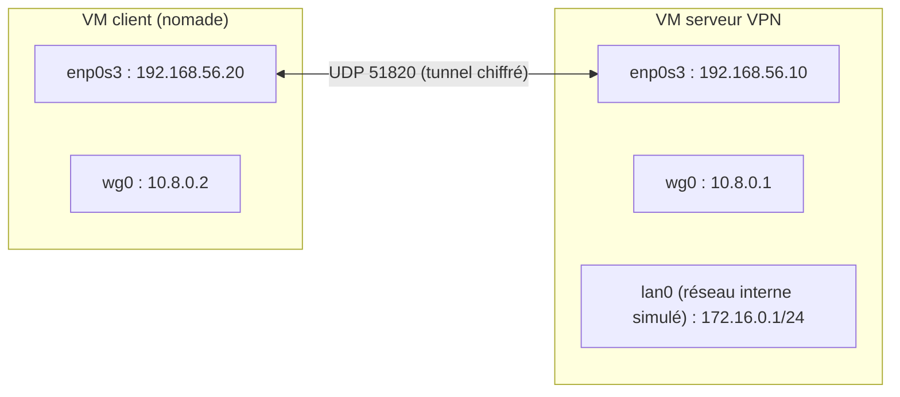

# TP – Monter un tunnel WireGuard entre un client nomade et un serveur

*BTS SIO SISR 1re année – Bloc 3 – S13*

> [!NOTE]
> **But.** Situation : Comment permettre à un utilisateur à distance d'accéder au réseau de l'entreprise sans exposer ses échanges ?
>
> **Comment ce TP fonctionne.** Avant de manipuler, tu écris ce que tu **anticipes** (« J'anticipe »). Puis tu testes et tu notes ce que tu **constates**. Tu **comprends** ce que fait chaque commande (« Je comprends »). Un **bilan de compétences** clôt la séance. Les manipulations se font sur des **machines virtuelles de laboratoire**, isolées du réseau de l'établissement. Les identifiants communs d'un TP sont des **identifiants de laboratoire** : ils ne se réutilisent jamais ailleurs.

## Objectif

Monter un tunnel VPN WireGuard entre un poste nomade (client) et un serveur, vérifier que le trafic est chiffré, maîtriser les adresses autorisées, puis analyser des scénarios d'entreprise.

## Contraintes

- Binôme, durée : 3 h 20. Deux VM Debian de laboratoire sur un **réseau interne** isolé.
- Les adresses sont des valeurs de laboratoire. **Aucune clé privée** ne figure dans le rendu : tu masques les lignes `PrivateKey`.

## Schéma du laboratoire



| Machine | Interface | Adresse |
|---|---|---|
| Client | réseau interne | `192.168.56.20/24` |
| Client | tunnel `wg0` | `10.8.0.2/24` |
| Serveur | réseau interne | `192.168.56.10/24` |
| Serveur | tunnel `wg0` | `10.8.0.1/24` |
| Serveur | réseau d'entreprise simulé `lan0` | `172.16.0.1/24` |

## Partie A. Préparer les machines (30 min)

Sur les **deux** VM :

```bash
sudo apt update && sudo apt install -y wireguard tcpdump
wg --version
sudo mkdir -p /etc/wireguard && sudo chmod 700 /etc/wireguard
```

Sur le **serveur**, simule le réseau interne de l'entreprise avec une interface fictive :

```bash
sudo ip link add lan0 type dummy
sudo ip addr add 172.16.0.1/24 dev lan0
sudo ip link set lan0 up
ip -br addr
```

Génère une paire de clés **sur chaque machine** (jamais sur une autre machine) :

```bash
cd /etc/wireguard
wg genkey | sudo tee privee.key | wg pubkey | sudo tee publique.key
sudo chmod 600 privee.key
sudo cat publique.key
```

**Je comprends.**

| Commande | Rôle |
|---|---|
| `wg genkey` | Génère une clé **privée** |
| `wg pubkey` | Calcule la clé **publique** correspondante |
| `chmod 600` | La clé privée n'est lisible que par root |
| `dummy` | Interface virtuelle : simule un réseau derrière le serveur |

**Questions.**

1. Quelle clé échanges-tu avec l'autre machine ? Laquelle ne quitte jamais sa machine ? ______________________
2. Quelle est la longueur et l'encodage d'une clé WireGuard ? ______________________

## Partie B. Configurer et démarrer le tunnel (50 min)

### B1. Serveur : `/etc/wireguard/wg0.conf`

Remplace `<PRIVEE_SERVEUR>` par le contenu de `privee.key` du serveur et `<PUBLIQUE_CLIENT>` par la clé publique du client.

```ini
[Interface]
Address = 10.8.0.1/24
ListenPort = 51820
PrivateKey = <PRIVEE_SERVEUR>

[Peer]
PublicKey = <PUBLIQUE_CLIENT>
AllowedIPs = 10.8.0.2/32
```

### B2. Client : `/etc/wireguard/wg0.conf`

```ini
[Interface]
Address = 10.8.0.2/24
PrivateKey = <PRIVEE_CLIENT>

[Peer]
PublicKey = <PUBLIQUE_SERVEUR>
Endpoint = 192.168.56.10:51820
AllowedIPs = 10.8.0.1/32, 172.16.0.0/24
PersistentKeepalive = 25
```

```bash
sudo chmod 600 /etc/wireguard/wg0.conf
sudo wg-quick up wg0
sudo wg show
ip -br addr show wg0
ip route
```

**Je comprends.**

| Ligne | Rôle |
|---|---|
| `Address` | Adresse de la machine **dans le tunnel** |
| `ListenPort` | Port UDP sur lequel le serveur écoute |
| `PrivateKey` | Clé **privée** de **cette** machine |
| `[Peer]` + `PublicKey` | Le pair (l'autre machine) est identifié par sa clé **publique** |
| `Endpoint` | Adresse et port **réels** du serveur (côté client) |
| `AllowedIPs` | Adresses autorisées pour ce pair : routage à l'envoi, filtrage à la réception |
| `PersistentKeepalive = 25` | Envoi d'un paquet toutes les 25 s : maintient le tunnel derrière un NAT |
| `wg-quick up` | Crée l'interface et ajoute les routes |

**J'anticipe.** Avant d'essayer : depuis le client, `ping 172.16.0.1` va-t-il passer par le tunnel ? Et `ping 10.8.0.1` ? ______________________

<details markdown="1">
<summary>Éléments de réponse</summary>

**Oui pour les deux** : `AllowedIPs` du client contient `10.8.0.1/32` et `172.16.0.0/24`, donc ces destinations sont routées dans le tunnel. Le serveur accepte les paquets dont la source est `10.8.0.2` (client autorisé).

</details>

```bash
ping -c 3 10.8.0.1
ping -c 3 172.16.0.1
sudo wg show
```

**Questions.**

3. Que montrent `latest handshake` et `transfer` dans `wg show` ? ______________________
4. Quelle route `wg-quick` a-t-il ajoutée sur le client pour `172.16.0.0/24` ? ______________________
5. Le client peut-il joindre une autre adresse du réseau d'entreprise, par exemple `172.16.0.99` ? Pourquoi ? ______________________
6. Que se passe-t-il si le serveur ne connaît pas (ou a mal recopié) la clé publique du client ? ______________________

## Partie C. Observer le trafic (40 min)

Sur le **serveur**, capture sur l'interface réseau réelle (adapte son nom) pendant que le client fait des `ping` :

```bash
sudo tcpdump -ni enp0s3 -c 10 udp port 51820
```

Dans une deuxième console, capture **dans** le tunnel :

```bash
sudo tcpdump -ni wg0 -c 10
```

Pendant ce temps, sur le client :

```bash
ping -c 5 172.16.0.1
```

**J'anticipe.** Sur `enp0s3` verras-tu les `ping` (ICMP) ? Sur `wg0` ? ______________________

<details markdown="1">
<summary>Éléments de réponse</summary>

Sur `enp0s3` : seulement des **paquets UDP** vers le port 51820 dont le contenu est chiffré, **pas d'ICMP**. Sur `wg0` : les `ping` en clair, car l'interface du tunnel voit le trafic **après** déchiffrement.

</details>

**Questions.**

7. Que voit un observateur placé sur le réseau entre les deux machines ? ______________________
8. Que ne voit-il **pas** ? ______________________
9. Que voit-il malgré le chiffrement (adresses, ports, tailles, rythme) ? Pourquoi est-ce acceptable ou non ? ______________________

## Partie D. Restreindre et tester (40 min)

### D1. Restreindre les adresses autorisées

Sur le **client**, arrête le tunnel, modifie `AllowedIPs` pour ne garder que `10.8.0.1/32`, puis redémarre :

```bash
sudo wg-quick down wg0
# éditer /etc/wireguard/wg0.conf : AllowedIPs = 10.8.0.1/32
sudo wg-quick up wg0
ping -c 2 172.16.0.1
ping -c 2 10.8.0.1
```

10. Le `ping 172.16.0.1` fonctionne-t-il encore ? Pourquoi ? ______________________

### D2. Tunnel complet

Remets `172.16.0.0/24` et teste `AllowedIPs = 0.0.0.0/0` sur le client (sans arrêter l'accès à ton réseau de TP, car la route par défaut passe alors par le tunnel) :

```bash
sudo wg-quick down wg0
# AllowedIPs = 0.0.0.0/0
sudo wg-quick up wg0
ip route
```

11. Quelles routes apparaissent ? Quel est l'effet sur le trafic Internet du client ? ______________________
12. Pour quel type de politique de sécurité choisit-on un tunnel complet ? ______________________

### D3. Révoquer un client

Sur le serveur, supprime le pair du client sans arrêter le service :

```bash
sudo wg set wg0 peer <PUBLIQUE_CLIENT> remove
sudo wg show
```

13. Le client peut-il encore joindre le serveur ? Comment le constates-tu ? ______________________
14. Que faut-il prévoir pour qu'un employé qui perd son ordinateur portable ne laisse pas un accès ouvert ? ______________________

### D4. Sécuriser le service

15. Quel port le pare-feu de la passerelle doit-il laisser ouvrir pour WireGuard ? ______________________
16. Pourquoi ne faut-il pas ouvrir `AllowedIPs = 0.0.0.0/0` côté **serveur** pour un client nomade ? ______________________

## Partie E. Analyser des scénarios (20 min)

Pour chaque situation, choisis un type de VPN et un protocole, et justifie.

| # | Situation | Type | Protocole | Mesures de sécurité |
|---|---|---|---|---|
| 1 | 30 télétravailleurs accèdent à l'ERP du siège. | | | |
| 2 | Une agence de 8 postes doit être reliée en permanence au siège (deux pare-feu). | | | |
| 3 | Un prestataire de maintenance doit accéder à **un seul** serveur, 2 h par mois. | | | |


## Retour en entreprise

Si ta situation le permet : **observe** comment ton entreprise traite ce sujet, **note** en quelques lignes l'écart avec le TP, et, avec l'accord de ton tuteur, **réalise** une partie sur une situation réelle. Anonymise tes captures. Voir [Transfert en entreprise](../../ressources/transfert-entreprise.md).

## Bilan de la séance

Remplis ce bilan **seul**, honnêtement : il sert à décider ce qu'il faut reprendre. Niveau : **Non maîtrisé**, **Maîtrise partielle**, **Bonne maîtrise** ou **Excellente maîtrise** (le vocabulaire des grilles nationales d'évaluation) ; **Non évalué** si tu n'as pas travaillé la compétence aujourd'hui.

| Compétence du référentiel | Ce que j'ai fait dans cette séance | Niveau |
|---|---|---|
| **B3.4** – Garantir la disponibilité, l'intégrité et la confidentialité des services informatiques et des données de l'organisation face à des cyberattaques | | |
| **B3.5A** – Assurer la cybersécurité d'une infrastructure réseau, d'un système, d'un service | | |

> [!NOTE]
> Les codes sont ceux du [référentiel](../../ressources/referentiel.md) (l'arrêté numérote des activités : les codes « B… » sont un usage courant). Le choix des compétences pour cette séance est une proposition de l'enseignant, **à valider**.

**Je sais faire, sans aide :**

- [ ] Générer les clés WireGuard d'une machine ;
- [ ] Écrire la configuration d'un serveur et d'un client ;
- [ ] Vérifier l'état d'un tunnel et son trafic ;
- [ ] Restreindre les adresses autorisées dans le tunnel ;
- [ ] Distinguer tunnel complet et tunnel partiel.

**Ce que je dois reprendre :** ______________________

**Ma question à poser à l'enseignant :** ______________________
