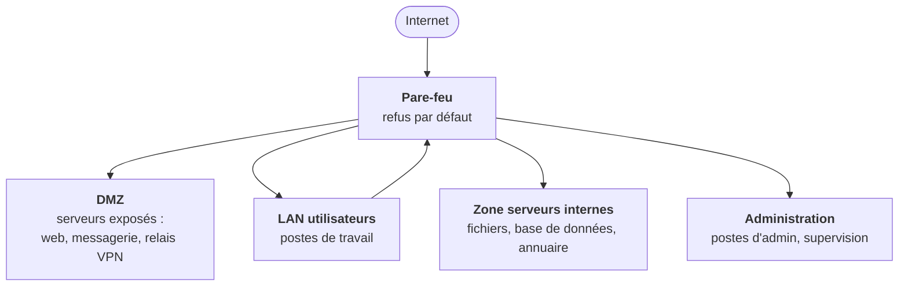

# Cours – Architecture réseau sécurisée et durcissement

*BTS SIO SISR 1re année – Bloc 3 – S14 – à lire avant le [TP](02-tp.md)*

> [!NOTE] Ce que tu dois savoir déjà
> - **Prérequis :** S04 (droits), S11 à S13 (TLS, VPN) ; notions d'adressage IP et de pare-feu.
> - **Matériel :** Deux VM Debian de laboratoire (`openssh-server`, `ufw`, `lynis`) ; éditeur de schémas ou papier

## À la fin de ce cours tu sauras

- [ ] **Appliquer** les principes de défense en profondeur et de cloisonnement à un réseau d'entreprise ;
- [ ] **Concevoir** des zones (LAN, DMZ, administration) et **écrire** la matrice de flux autorisés ;
- [ ] **Durcir** un serveur Linux : services, SSH par clés, pare-feu, mises à jour ;
- [ ] **Mesurer** le durcissement avec un outil d'audit (Lynis) avant et après ;
- [ ] **Citer** les référentiels de bonnes pratiques (ANSSI, CIS) et leur usage.

## I. Principes d'une architecture sécurisée

| Principe | Idée | Exemple |
|---|---|---|
| **Défense en profondeur** | Plusieurs couches : une défaillance ne suffit pas à tout compromettre | Pare-feu + durcissement + droits + sauvegardes + supervision |
| **Moindre privilège** (S04) | Chaque élément n'a que ce qui lui est nécessaire | Le serveur web n'accède pas à la base RH |
| **Cloisonnement** | Séparer les zones pour limiter la propagation | Un poste infecté n'atteint pas les serveurs |
| **Refus par défaut** | Tout est interdit sauf ce qui est explicitement autorisé | Règle finale du pare-feu : *deny all* |
| **Réduction de la surface d'attaque** | Moins de services, moins de ports, moins de logiciels | Désinstaller ce qui ne sert pas |
| **Séparation des rôles** | Administration séparée de l'utilisation | Réseau d'administration dédié |

## II. Zones et flux

On découpe le réseau en **zones de confiance** et on contrôle les flux entre elles avec un **pare-feu**.

| Zone | Contenu | Règles typiques |
|---|---|---|
| **Internet** (non sûre) | Le monde extérieur | Aucun accès direct au réseau interne |
| **DMZ** (zone démilitarisée) | Services **exposés** à Internet | Entrées limitées aux ports du service ; **pas d'accès libre** vers l'interne |
| **LAN utilisateurs** | Postes de travail | Sorties contrôlées ; accès aux serveurs limités |
| **Serveurs internes** | Données et services | Accessibles seulement depuis les zones qui en ont besoin |
| **Administration** | Postes et outils des administrateurs | Seuls ces postes administrent (SSH, RDP, supervision) |

Les zones se matérialisent par des **VLAN** et des sous-réseaux distincts, reliés par un routeur ou un pare-feu qui applique la **matrice de flux**.

### La matrice de flux

C'est un tableau qui dit **qui peut parler à qui, sur quel port**. Tout ce qui n'y figure pas est refusé.

| De ↓ / Vers → | Internet | DMZ | Serveurs | Administration |
|---|---|---|---|---|
| **Internet** | — | 443 (web) | ✗ | ✗ |
| **LAN** | 80, 443 | 443 | 445 (partage), 53 (DNS) | ✗ |
| **DMZ** | 53, mises à jour | — | 3306 (base, depuis le web seulement) | ✗ |
| **Administration** | ✔ | 22 | 22, 3389 | — |

Une matrice **courte et justifiée** est plus sûre qu'une liste de règles accumulées sans explication. Chaque ligne doit avoir un **propriétaire** et une **raison**.

### Quelques bonnes pratiques de réseau

- **Segmenter** l'accès Wi-Fi invités, les imprimantes et les objets connectés (zones à part).
- **Désactiver les ports inutilisés** des commutateurs et utiliser l'authentification 802.1X quand c'est possible.
- Un **bastion** (poste d'administration unique, journalisé) pour l'accès aux serveurs.
- **Superviser** le trafic entre zones (S15).

## III. Durcir un système

Le **durcissement** (*hardening*) consiste à **réduire la surface d'attaque** d'un système en le configurant au plus juste.

### Les familles de mesures

| Famille | Mesures |
|---|---|
| **Services et logiciels** | Ne garder que ce qui est nécessaire ; supprimer les services inutiles ; ports ouverts connus (`ss -tlnp`) |
| **Mises à jour** | Correctifs de sécurité appliqués rapidement (automatiques si possible) |
| **Comptes et accès** | Pas de connexion directe de `root` ; authentification par clé ; mots de passe forts ; comptes inutiles supprimés |
| **Pare-feu local** | Refus par défaut, ouverture des seuls ports utiles |
| **Journalisation** | Journaux activés, centralisés et horodatés (S15) |
| **Chiffrement** | Disques (S05), communications (TLS, SSH) |
| **Configuration de base** | Mêmes paramètres sur toutes les machines (modèle, automatisation) |

### SSH, la porte d'administration d'un serveur Linux

| Réglage | Valeur | Effet |
|---|---|---|
| `PermitRootLogin` | `no` | Pas de connexion directe en administrateur |
| `PasswordAuthentication` | `no` | Seulement par **clé** : plus de mot de passe à deviner |
| `PubkeyAuthentication` | `yes` | Authentification par clé publique |
| `MaxAuthTries` | `3` | Peu d'essais par connexion |
| `AllowUsers` | liste | Seuls les comptes cités peuvent se connecter |
| `X11Forwarding` | `no` | Moins de fonctionnalités exposées |

### Windows

Sous Windows, le durcissement se déploie par **stratégie de groupe** (GPO) : politique de mots de passe, verrouillage de compte, désactivation de **SMBv1** et d'anciens protocoles, restriction des administrateurs locaux, journalisation avancée, pare-feu activé, **AppLocker**/contrôle des applications. Les paramètres se rassemblent dans un **modèle de base** appliqué à toutes les machines d'un même type.

## IV. Les référentiels

On ne durcit pas « de mémoire » : on s'appuie sur des guides reconnus.

| Référentiel | Éditeur | Contenu |
|---|---|---|
| **Guide d'hygiène informatique** | ANSSI | Mesures de sécurité essentielles pour toute organisation |
| **Recommandations de configuration** (Linux, Windows, TLS, SSH, réseau…) | ANSSI | Guides techniques par sujet |
| **CIS Benchmarks** | Center for Internet Security | Listes détaillées de réglages par système, avec niveaux |
| **Lynis**, **OpenSCAP**, **audits de conformité** | Outils libres | Vérifient la configuration d'un système et proposent des améliorations |

> [!NOTE]
> Un référentiel est un **point de départ**, pas une liste à appliquer sans réfléchir : chaque réglage est évalué selon le **contexte** (exposition du serveur, impact sur les utilisateurs). On documente les **écarts assumés**.

## V. Durcir sans se couper l'accès

Quelques réflexes évitent les pannes de configuration :

1. Garder une **seconde session** ouverte avant de modifier SSH ou le pare-feu ;
2. **Tester** la configuration avant de recharger (`sshd -t`, `nginx -t`) ;
3. Ouvrir la règle d'accès (par exemple le port 22) **avant** d'activer le pare-feu ;
4. Garder une **console** hors réseau (console de la VM) pour le dépannage ;
5. Procéder par étapes, **une mesure à la fois**, et noter ce qui change.

## À retenir

- **Défense en profondeur**, **moindre privilège**, **cloisonnement**, **refus par défaut**.
- Zones : Internet, **DMZ**, LAN, serveurs, administration ; la **matrice de flux** liste ce qui est autorisé, le reste est refusé.
- Durcir = réduire la **surface d'attaque** : services, correctifs, comptes, SSH par clés, pare-feu local.
- S'appuyer sur les guides de l'**ANSSI** et les **CIS Benchmarks**, mesurer avec un outil (Lynis).
- Toujours pouvoir revenir en arrière : session de secours, test avant rechargement.
