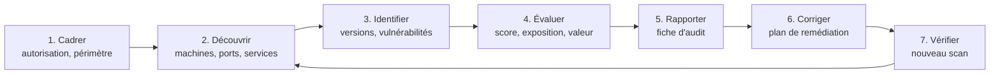

# Cours – Audit de vulnérabilités : cadre, scans, CVE et CVSS

*BTS SIO SISR 1re année – Bloc 3 – S16 – à lire avant le [TP](02-tp.md)*

> [!NOTE] Ce que tu dois savoir déjà
> - **Prérequis :** S09 (infractions, autorisation), S14 (durcissement), S15 (journaux, détection).
> - **Matériel :** VM Debian `adm` (`nmap`) et VM Debian cible `srv` (`nginx`, `vsftpd`) sur un réseau interne isolé

## À la fin de ce cours tu sauras

- [ ] **Rédiger** une autorisation d'audit précisant périmètre, dates et règles ;
- [ ] **Distinguer** découverte, scan de ports, détection de services et scan de vulnérabilités ;
- [ ] **Utiliser** Nmap pour découvrir les machines, les ports ouverts et les versions de services ;
- [ ] **Interpréter** une référence CVE et un score CVSS, et **prioriser** les corrections ;
- [ ] **Rédiger** une fiche d'audit et un plan de remédiation.

## I. Pourquoi auditer ?

Un **audit de vulnérabilités** recherche les failles d'un système **avant** qu'un attaquant ne les exploite. Une **vulnérabilité** est une faiblesse (logiciel non corrigé, mauvaise configuration, mot de passe faible) qui peut être exploitée par une menace (S01).

L'audit est **récurrent** : de nouvelles vulnérabilités sont publiées chaque jour. Un scan régulier fait partie de la gestion du parc (S02, S14).

## II. Le cadre légal : l'autorisation

> [!WARNING]
> **Scanner un système sans autorisation peut constituer une infraction** (accès ou tentative d'accès frauduleux, entrave : S09, articles 323-1 et suivants du Code pénal). Le but, « m'entraîner » ou « aider », n'efface pas l'infraction. **Toujours** une **autorisation écrite** du propriétaire du système.

Elle précise au minimum :

| Élément | Exemple |
|---|---|
| **Qui autorise** | Représentant légal ou responsable désigné |
| **Qui réalise** | Nom de l'auditeur ou du prestataire |
| **Périmètre** | Plages d'adresses, noms de domaine, systèmes **inclus** et **exclus** |
| **Période** | Dates et plages horaires |
| **Méthodes** | Scan de ports et de vulnérabilités ; pas d'exploitation, pas de déni de service |
| **Contacts d'urgence** | Qui prévenir en cas d'incident pendant le test |
| **Confidentialité** | Traitement du rapport et des données rencontrées |
| **Livrable** | Rapport, restitution |

Un audit chez un **tiers** (client, hébergeur) exige l'accord de **ce tiers** : le consentement du client ne suffit pas pour scanner l'infrastructure de son hébergeur.

## III. Types d'approche

| Approche | L'auditeur dispose de… | Avantage |
|---|---|---|
| **Boîte noire** | Rien (il se place en attaquant externe) | Vue réaliste de l'extérieur |
| **Boîte grise** | Quelques informations (un compte, un schéma) | Compromis pertinence/temps |
| **Boîte blanche** | Toutes les informations (configurations, code) | Exhaustif |

On distingue aussi :

| | **Scan non authentifié** | **Scan authentifié** |
|---|---|---|
| Principe | Vue extérieure : ports, bannières | Se connecte avec un compte pour lire les versions et la configuration |
| Résultat | Moins précis, moins de faux positifs d'accès | Plus complet |

Un **scan de vulnérabilités** (outil automatisé) n'est pas un **test d'intrusion** (un humain tente de les exploiter pour mesurer l'impact) : le premier **liste**, le second **démontre**.

## IV. Les étapes d'un scan avec Nmap

**Nmap** est l'outil de référence pour explorer un réseau.

| Étape | Question | Commande |
|---|---|---|
| **Découverte** | Quelles machines répondent ? | `nmap -sn 192.168.56.0/24` |
| **Ports** | Quels ports sont ouverts ? | `nmap -sS -p- 192.168.56.10` |
| **Services et versions** | Quel logiciel, quelle version ? | `nmap -sV -p 21,22,80,443 192.168.56.10` |
| **Système** | Quel système d'exploitation ? | `nmap -O 192.168.56.10` |
| **Scripts** | Un contrôle précis (accès anonyme, chiffrement) | `nmap --script ftp-anon -p 21 192.168.56.10` |
| **Sauvegarde** | Conserver la preuve | `-oN scan.txt` (texte) ou `-oX scan.xml` |

### Les états d'un port

| État | Sens |
|---|---|
| **open** | Un service écoute et répond |
| **closed** | Accessible, mais aucun service n'écoute |
| **filtered** | Un pare-feu filtre : pas de réponse exploitable |

> [!NOTE]
> Un scan **bruyant** laisse des traces dans les journaux et déclenche des alertes (S15) : c'est normal et utile pour tester la détection. Prévenir l'équipe de supervision avant un scan en production.

## V. CVE et CVSS

### CVE

Une **CVE** (*Common Vulnerabilities and Exposures*) est un identifiant unique de vulnérabilité connue, au format `CVE-ANNÉE-NUMÉRO` (par exemple `CVE-2017-0144`). On y associe le logiciel concerné, les versions touchées, et une description. Les fiches sont consultables sur la base **NVD** (*National Vulnerability Database*) et sur les bulletins des éditeurs et du **CERT-FR**.

### CVSS

Le **CVSS** (*Common Vulnerability Scoring System*) note la **gravité technique** d'une vulnérabilité de 0 à 10.

| Score | Gravité |
|---|---|
| 0,0 | Aucune |
| 0,1 à 3,9 | **Faible** |
| 4,0 à 6,9 | **Moyenne** |
| 7,0 à 8,9 | **Élevée** |
| 9,0 à 10,0 | **Critique** |

Le score dépend de critères comme le **vecteur d'attaque** (réseau ou local), la **complexité**, les **privilèges requis**, l'**interaction de l'utilisateur** et l'impact sur la confidentialité, l'intégrité et la disponibilité.

### Prioriser : le score ne suffit pas

On croise le score avec le **contexte** :

| Critère | Questions |
|---|---|
| **Exposition** | La machine est-elle accessible depuis Internet ? depuis le LAN seulement ? |
| **Exploitabilité** | Existe-t-il un code d'exploitation public ? La vulnérabilité est-elle **activement exploitée** (catalogues des vulnérabilités exploitées) ? |
| **Valeur du bien** | Données personnelles, serveur critique, poste de test ? |
| **Facilité de correction** | Correctif disponible ? Arrêt nécessaire ? Mesure de contournement ? |

Une vulnérabilité « moyenne » sur un serveur exposé et critique peut passer **avant** une « élevée » sur un poste isolé.

## VI. Le rapport d'audit

Une **fiche d'audit** doit être lisible par la direction **et** exploitable par les techniciens :

| Rubrique | Contenu |
|---|---|
| **Cadre** | Périmètre, dates, méthode, outils et versions |
| **Synthèse** | Résultat global en quelques lignes, nombre de vulnérabilités par gravité |
| **Constats** | Pour chacun : machine, port, service, vulnérabilité (CVE), score, **preuve** (extrait du scan) |
| **Risque** | Impact métier, exposition |
| **Recommandations** | Action précise, priorité, responsable, échéance |
| **Suivi** | Nouveau scan après correction |

Les **recommandations** donnent la **marche à suivre** (mettre à jour tel paquet vers telle version, désactiver tel service, restreindre tel port), pas seulement le constat.

## À retenir

- **Pas d'audit sans autorisation écrite** : périmètre, dates, méthodes, contacts.
- Découverte → ports → services et versions → vulnérabilités → rapport → correction → **nouveau scan**.
- **CVE** identifie une vulnérabilité ; **CVSS** note sa gravité de 0 à 10 (faible, moyenne, élevée, critique).
- Prioriser = score **et** exposition, exploitabilité, valeur du bien.
- Un scan **liste** ; un test d'intrusion **démontre** ; la fiche d'audit propose des actions concrètes.
