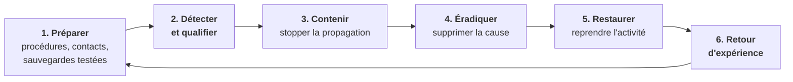

# Cours – Réponse à incident : méthode, communication et preuves

*BTS SIO SISR 1re année – Bloc 3 – S17 – à lire avant le [TP](02-tp.md)*

> [!NOTE] Ce que tu dois savoir déjà
> - **Prérequis :** S05 (sauvegardes), S08 (violations), S09 (preuve, plainte), S15 (journaux).
> - **Matériel :** VM Debian de laboratoire ; fiches papier ou traitement de texte

## À la fin de ce cours tu sauras

- [ ] **Décrire** les phases d'une réponse à incident (préparation, détection, qualification, confinement, éradication, restauration, retour d'expérience) ;
- [ ] **Qualifier** un incident et décider des premières actions dans l'ordre ;
- [ ] **Identifier** qui prévenir (direction, DPO, CNIL, assureur, police, clients) et dans quel délai ;
- [ ] **Collecter** des informations volatiles avec un script et en garantir l'intégrité par une empreinte ;
- [ ] **Rédiger** une main courante et un retour d'expérience.

## I. Un incident, une méthode

Un **incident de sécurité** est un événement qui compromet ou menace la confidentialité, l'intégrité ou la disponibilité d'un système ou de données : rançongiciel, compte compromis, fuite, déni de service, perte d'un matériel. Face à la pression, on suit une **méthode** pour ne pas improviser.

| Phase | Objectif | Exemples |
|---|---|---|
| **Préparer** | Être prêt avant | Liste des contacts, procédure écrite, sauvegardes hors ligne et **testées** (S05), journaux (S15) |
| **Détecter et qualifier** | Savoir ce qui se passe | Alerte, signalement d'un utilisateur ; **périmètre**, **gravité**, données touchées ? |
| **Contenir** | Limiter les dégâts | Isoler les machines du réseau, couper les comptes compromis, bloquer l'adresse malveillante |
| **Éradiquer** | Supprimer la cause | Retirer le logiciel malveillant, corriger la faille, changer les mots de passe |
| **Restaurer** | Reprendre | Restaurer depuis une sauvegarde **saine**, vérifier, surveiller de près |
| **Retour d'expérience** | Apprendre | Réunion, rapport, actions d'amélioration |

> [!NOTE]
> Avant de **restaurer**, il faut **éradiquer** : restaurer sur un système encore compromis, c'est se faire attaquer à nouveau.

## II. Les premières heures

### Qui fait quoi ?

| Rôle | Mission |
|---|---|
| **Responsable de crise** (direction) | Décide, arbitre, porte la responsabilité |
| **Pilote technique** | Coordonne l'analyse et les actions |
| **Techniciens** | Exécutent (isolement, collecte, restauration) |
| **DPO** | Évalue l'atteinte aux données personnelles (S08) |
| **Communication** | Informe clients, partenaires, salariés |
| **Scribe** | Tient la **main courante** (qui, quoi, quand) |

Même dans une petite structure, on **désigne** ces rôles : un administrateur seul ne peut pas à la fois réparer, décider et communiquer.

### La main courante

Un journal **horodaté** de tout ce qui est constaté et décidé : « 08:25 – 3 postes affichent un message de rançon ; décision de couper le réseau (J. Martin) ». Elle sert à comprendre, à rendre compte, à prouver et à faire le retour d'expérience.

### Réflexes face à un rançongiciel

| À faire | À éviter |
|---|---|
| **Isoler** les machines touchées du réseau (câble, Wi-Fi) | Éteindre sans réfléchir : on perd la mémoire vive (indices), mais cela peut aussi stopper un chiffrement en cours : **décision** à prendre en connaissance de cause |
| **Préserver** les sauvegardes (les débrancher ou les isoler avant qu'elles ne soient chiffrées) | Se connecter avec un compte administrateur sur une machine infectée |
| **Prévenir** la direction et le contact sécurité | Supprimer ou « nettoyer » avant d'avoir collecté les preuves |
| **Noter** l'heure et les symptômes | Payer la rançon sans analyse : le paiement ne garantit ni la restitution ni l'absence de revente des données, et finance les attaquants. Les autorités déconseillent de payer |
| **Déposer plainte** | Communiquer sur le sujet avant d'avoir qualifié les faits |

## III. Qui prévenir ?

| Destinataire | Quand | Pourquoi |
|---|---|---|
| **Direction** | Tout de suite | Décision, ressources |
| **DPO / responsable données** | Tout de suite | Violation de données ? (S08) |
| **CNIL** | Sous **72 h** si des données personnelles sont touchées avec un risque | Obligation légale (S08) |
| **Personnes concernées** | Si le risque pour elles est **élevé** | Obligation légale (S08) |
| **Assureur** (cyber) | Dans les délais du contrat | Prise en charge, experts |
| **Police ou gendarmerie** | Rapidement | Plainte : nécessaire pour l'assurance et l'enquête |
| **ANSSI / CERT-FR** | Selon le statut de l'organisation (opérateurs essentiels, entités réglementées) | Obligations sectorielles, appui |
| **Cybermalveillance.gouv.fr** | Pour les entreprises et collectivités victimes | Diagnostic, mise en relation avec des prestataires |
| **Clients, partenaires** | Après qualification et décision de la direction | Transparence, éviter la propagation |

## IV. La préservation des preuves

Pour qu'une trace serve en justice ou auprès de l'assurance, elle doit être **authentique** et **intègre** (S09). Les règles :

1. **Ne pas altérer** : travailler sur des **copies**, jamais sur l'original quand c'est possible.
2. **Respecter l'ordre de volatilité** : collecter d'abord ce qui disparaît le plus vite.
3. **Garantir l'intégrité** : calculer l'**empreinte SHA-256** de chaque élément collecté (S10).
4. **Documenter** : qui a collecté, quand, comment, avec quel outil.
5. **Conserver la chaîne** de possession : où est la preuve, qui l'a manipulée.
6. **Stocker** les preuves sur un support **externe** à la machine analysée.

| Ordre de volatilité | Exemple | Commande Linux |
|---|---|---|
| 1. Mémoire, état du système | Connexions réseau, processus, utilisateurs connectés | `ss -tupan`, `ps`, `who` |
| 2. Fichiers temporaires | `/tmp`, caches | `ls -la /tmp` |
| 3. Disque | Fichiers, journaux | Copie du disque, `journalctl` |
| 4. Journaux distants et sauvegardes | Serveur de journaux, pare-feu | Export, copie |

> [!WARNING]
> Un administrateur qui « nettoie » une machine avant la collecte détruit des preuves. Dans le doute : **isoler, collecter, puis agir**.

## V. Le retour d'expérience

Après la crise, une réunion (sans recherche de coupable) répond à : que s'est-il passé ? comment l'a-t-on détecté ? qu'a-t-on bien/mal fait ? quelle a été la cause racine ? Quelles **actions** pour que cela ne se reproduise pas (avec un responsable et une échéance) ?

## À retenir

- Méthode : **préparer → détecter/qualifier → contenir → éradiquer → restaurer → retour d'expérience**.
- Désigner des **rôles** et tenir une **main courante** horodatée.
- Rançongiciel : **isoler**, préserver les sauvegardes, **ne pas payer sans analyse**, collecter les preuves.
- Prévenir : direction, DPO, **CNIL sous 72 h** si données touchées, assureur, police, selon le cas.
- Preuves : **copies**, **ordre de volatilité**, **empreintes**, documentation, chaîne de possession.
